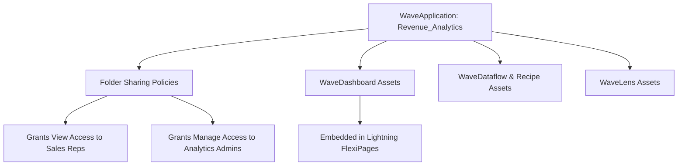

## Architectural Overview

The `WaveApplication` metadata type represents an application container (folder) within Salesforce CRM Analytics (formerly Einstein Analytics and Tableau CRM). Similar to classic report and dashboard folders, `WaveApplication` provides the fundamental boundary for organizing related business intelligence assets—including CRM Analytics dashboards, lenses, datasets, recipes, and dataflows.

Beyond simple grouping, `WaveApplication` enforces governance and access boundaries. It dictates which user roles, public groups, or individual users possess `View`, `Edit`, or `Manage` permissions over the contained analytics artifacts. By version-controlling `WaveApplication` metadata within Salesforce DX repositories, architects ensure consistent security governance across development sandboxes, staging environments, and production.



## Directory and File Conventions

In Salesforce DX project source format, `WaveApplication` files are located inside the `wave/` directory alongside their child dashboards and recipes.

| Property | Value |
| :--- | :--- |
| **Metadata Type Name** | `WaveApplication` |
| **SFDX Folder** | `force-app/main/default/wave/` |
| **File Suffix** | `.waveApplication-meta.xml` or `.wave` |

## Key Metadata Fields

The `WaveApplication` XML schema incorporates the following core structural attributes:

| Field Name | Field Type | Required | Architectural Description |
| :--- | :--- | :--- | :--- |
| `masterLabel` | `string` | Yes | Display title rendered in the CRM Analytics Studio navigation panel. |
| `description` | `string` | No | Architectural description detailing purpose, target metrics, and ownership. |
| `folder` | `string` | Yes | Developer name representing the unique folder API identifier. |
| `shares` | `WaveFolderShare[]` | No | Array of access control entries defining permissions for users, roles, or groups. |
| `templateVersion` | `string` | No | Version string if the application was instantiated from an analytics template. |

> [!NOTE]
> All users, roles, and public groups declared in the `shares` block must exist in the target environment or the deployment will encounter permission mapping errors.

## Declarative XML and Package Manifest Examples

Below is an enterprise XML definition establishing an analytics folder for revenue operations:

```xml title="force-app/main/default/wave/Revenue_Operations.waveApplication-meta.xml"
<?xml version="1.0" encoding="UTF-8"?>
<WaveApplication xmlns="http://soap.sforce.com/2006/04/metadata">
    <description>Centralized revenue performance and sales pipeline analytics folder.</description>
    <folder>Revenue_Operations</folder>
    <masterLabel>Revenue Operations</masterLabel>
    <shares>
        <accessLevel>Manage</accessLevel>
        <sharedType>RoleAndSubordinates</sharedType>
        <sharedWith>VP_Sales</sharedWith>
    </shares>
    <shares>
        <accessLevel>View</accessLevel>
        <sharedType>AllPrmUsers</sharedType>
    </shares>
</WaveApplication>
```

### Manifest Definition (`package.xml`)

```xml title="manifest/package.xml"
<?xml version="1.0" encoding="UTF-8"?>
<Package xmlns="http://soap.sforce.com/2006/04/metadata">
    <types>
        <members>Revenue_Operations</members>
        <name>WaveApplication</name>
    </types>
    <version>68.0</version>
</Package>
```

## CLI Retrieval and Deployment Commands

Manage `WaveApplication` definitions with standard Salesforce CLI commands:

```bash
# Retrieve a specific WaveApplication
sf project retrieve start --metadata WaveApplication:Revenue_Operations

# Retrieve all WaveApplications in the org
sf project retrieve start --metadata WaveApplication

# Deploy the application to an analytics staging org
sf project deploy start --metadata WaveApplication:Revenue_Operations --target-org analytics-stage
```

## Architect Best Practices and Gotchas

- **Deployment Order in CI/CD:** Always deploy `WaveApplication` before deploying child assets like `WaveDashboard`, `WaveDataflow`, or `WaveLens` that reference the application folder in their XML definitions.
- **Role and Group Mapping Failures:** In multi-org architectures, avoid hardcoding user IDs or sandbox-specific roles inside `shares`; leverage standard public groups to keep metadata portable across scratch orgs.
- **De-provisioning Safeguards:** Deleting a `WaveApplication` deletes all contained dashboards and lenses. Ensure backups are stored in version control before performing teardowns.

> [!TIP]
> Use separate Wave applications for development work and executive production dashboards to prevent in-progress drafts from appearing in executive feeds.
