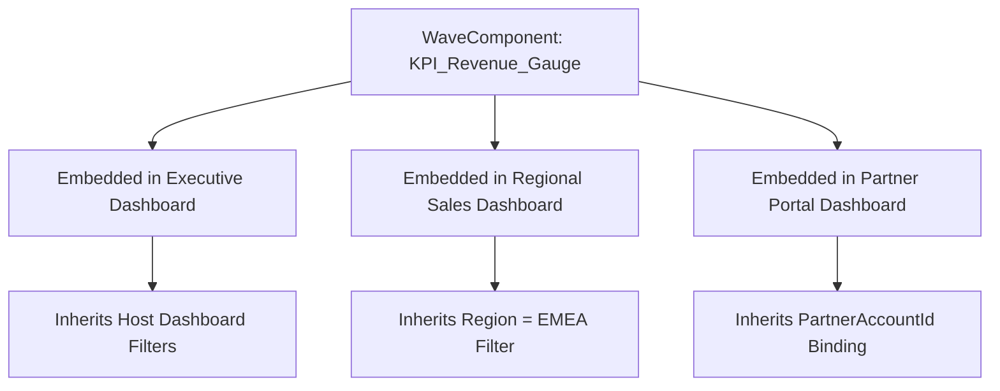

## Architectural Overview

The `WaveComponent` metadata type represents modular, reusable dashboard widgets within Salesforce CRM Analytics (formerly Tableau CRM and Einstein Analytics). In complex corporate analytics implementations, multiple dashboards frequently require identical operational widgets—such as a standardized Fiscal Year Revenue KPI card, a Customer Health Gauge, or an Escalated Cases Counter.

Without modular components, analytics authors duplicate query steps, layout containers, and conditional formatting rules across dozens of individual dashboards. `WaveComponent` establishes a reusable component architecture for CRM Analytics: developers author the query steps, charts, and parameter bindings once, then embed the component across any number of host dashboards. By storing `WaveComponent` definitions as version-controlled metadata in Salesforce DX, teams can build a standardized design system for enterprise business intelligence.



## Directory and File Conventions

In Salesforce DX project source format, `WaveComponent` files are located in the `wave/` directory with the `.wcomp-meta.xml` or `.waveComponent-meta.xml` suffix, accompanied by a JSON definition file containing the widget layout and query steps.

| Property | Value |
| :--- | :--- |
| **Metadata Type Name** | `WaveComponent` |
| **SFDX Folder** | `force-app/main/default/wave/` |
| **File Suffix** | `.wcomp-meta.xml` / `.wcomp` |

## Key Metadata Fields

The `WaveComponent` XML metadata definition exposes the following structural attributes:

| Field Name | Field Type | Required | Architectural Description |
| :--- | :--- | :--- | :--- |
| `masterLabel` | `string` | Yes | Human-readable label displayed in the CRM Analytics Component palette. |
| `description` | `string` | No | Architectural summary outlining component function and expected filter parameters. |
| `application` | `string` | Yes | Developer name of the parent `WaveApplication` housing the component. |
| `templateVersion` | `string` | No | Template version identifier if instantiated from an Analytics Template. |

> [!NOTE]
> The JSON payload defining the component layout, steps, and visual widgets accompanies the XML metadata header during retrieval and deployment.

## Declarative XML and Package Manifest Examples

Below is a declarative XML definition for a shared revenue KPI component:

```xml title="force-app/main/default/wave/Revenue_KPI_Gauge.wcomp-meta.xml"
<?xml version="1.0" encoding="UTF-8"?>
<WaveComponent xmlns="http://soap.sforce.com/2006/04/metadata">
    <application>Revenue_Operations</application>
    <description>Standardized revenue achievement gauge component for cross-dashboard embedding.</description>
    <masterLabel>Revenue KPI Gauge</masterLabel>
</WaveComponent>
```

### Accompanying Component Definition (`Revenue_KPI_Gauge.wcomp`)

```json title="force-app/main/default/wave/Revenue_KPI_Gauge.wcomp"
{
  "name": "Revenue_KPI_Gauge",
  "label": "Revenue KPI Gauge",
  "pages": [
    {
      "name": "default",
      "widgets": ["kpi_gauge_widget"]
    }
  ],
  "steps": {
    "aggregate_revenue": {
      "type": "aggregateflex",
      "query": {
        "measures": [["sum", "Amount"]]
      }
    }
  }
}
```

### Manifest Definition (`package.xml`)

```xml title="manifest/package.xml"
<?xml version="1.0" encoding="UTF-8"?>
<Package xmlns="http://soap.sforce.com/2006/04/metadata">
    <types>
        <members>Revenue_KPI_Gauge</members>
        <name>WaveComponent</name>
    </types>
    <version>68.0</version>
</Package>
```

## CLI Retrieval and Deployment Commands

Retrieve and deploy `WaveComponent` using standard Salesforce CLI commands:

```bash
# Retrieve a specific WaveComponent
sf project retrieve start --metadata WaveComponent:Revenue_KPI_Gauge

# Retrieve all WaveComponents in the org
sf project retrieve start --metadata WaveComponent

# Deploy component to an analytics sandbox
sf project deploy start --metadata WaveComponent:Revenue_KPI_Gauge --target-org analytics-dev
```

## Architect Best Practices and Gotchas

- **Parent Application Dependencies:** Deploy the parent `WaveApplication` before deploying `WaveComponent` to prevent unparented folder errors.
- **Dataset Consistency:** Verify that all datasets referenced inside the component step queries are present in the target environment and share identical schema field names.
- **Filter Faceting and Broadcasts:** Configure step faceting carefully; determine whether the embedded component should receive filter changes from the host dashboard or broadcast its selections outward.

> [!TIP]
> Package common analytics components into an internal unlocked package to distribute reusable BI design components across decentralized business units.
