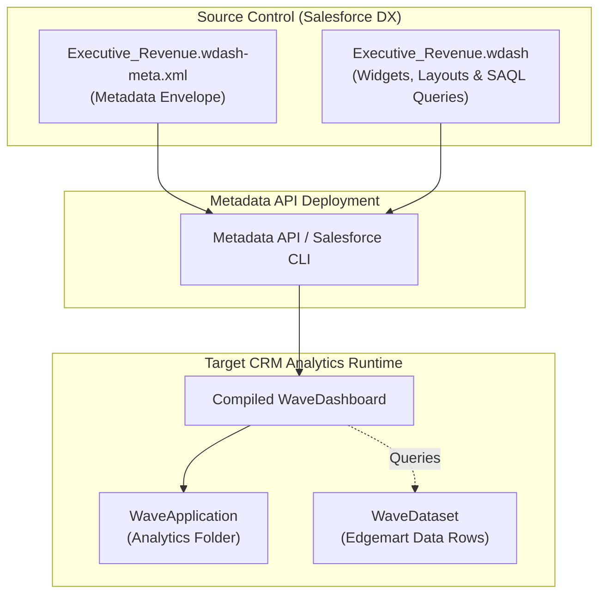

## Architectural Overview

The `WaveDashboard` metadata type represents an analytical dashboard within CRM Analytics (formerly Tableau CRM and Einstein Analytics). In enterprise Salesforce implementations, CRM Analytics dashboards serve as mission-critical executive control towers, combining cross-object relational records, historical snapshots, and high-volume external data streams into interactive visual layouts.

Architecturally, a `WaveDashboard` separates its high-level organizational metadata (such as parent application folders, titles, and descriptions) from its visual layout and query runtime state. While the metadata envelope is defined in XML, the inner mechanics—including visual widgets, responsive grid layouts, query steps (SAQL and compact forms), and dataset aliases—reside in a companion JSON asset.



Understanding this decoupled architecture is critical for Salesforce DevOps engineers. Deploying the dashboard layout without ensuring target dataset schema parity or parent folder existence will break release pipelines.

---

## Directory and File Suffix

In a Salesforce DX source directory, a `WaveDashboard` asset is stored in the `wave/` directory as a multi-file component:

- **JSON Definition File**: `force-app/main/default/wave/<DashboardName>.wdash`
- **Metadata Configuration File**: `force-app/main/default/wave/<DashboardName>.wdash-meta.xml`

```text
force-app/
└── main/
    └── default/
        └── wave/
            ├── Executive_Revenue_Pipeline.wdash
            └── Executive_Revenue_Pipeline.wdash-meta.xml
```

---

## Key Metadata Fields

The `.wdash-meta.xml` metadata descriptor encapsulates administrative and organizational properties:

| Field Name | Type | Required | Description |
|---|---|---|---|
| `application` | `string` | Yes | The DeveloperName of the parent `WaveApplication` (CRM Analytics app folder) housing this dashboard. |
| `masterLabel` | `string` | Yes | The human-readable title displayed in Analytics Studio and Lightning pages. |
| `description` | `string` | No | A description detailing dashboard audience, KPI definitions, and business intent. |
| `templateAssetSourceName` | `string` | No | The source developer name when this dashboard was generated from a `WaveTemplateBundle`. |

The `.wdash` file contains the complete JSON payload defining:
- `state.widgets`: Visual widgets including charts, KPI number counters, date pickers, and filter pills.
- `state.steps`: Underlying data queries, SAQL query strings, compact queries, and refresh intervals.
- `state.layouts`: Grid layouts specifying column spans, row heights, and mobile responsive variants.
- `datasets`: Array of referenced dataset identifiers and system aliases.

---

## Declarative XML Examples

### Metadata XML Descriptor (`wave/Executive_Revenue_Pipeline.wdash-meta.xml`)

```xml
<?xml version="1.0" encoding="UTF-8"?>
<WaveDashboard xmlns="http://soap.sforce.com/2006/04/metadata">
    <application>Executive_Analytics_Hub</application>
    <description>Provides executive leadership with real-time revenue pacing and pipeline conversion metrics.</description>
    <masterLabel>Executive Revenue Pipeline</masterLabel>
</WaveDashboard>
```

### Accompanying Dashboard Definition (`wave/Executive_Revenue_Pipeline.wdash`)

```json
{
  "version": "68.0",
  "state": {
    "widgets": {
      "kpi_total_revenue": {
        "parameters": {
          "step": "step_total_pipeline",
          "title": "Closed Won Revenue",
          "visualizationType": "pill"
        },
        "type": "number"
      }
    },
    "steps": {
      "step_total_pipeline": {
        "type": "aggregateflex",
        "query": {
          "measures": [["sum", "Amount"]],
          "groups": []
        },
        "datasets": [
          {
            "name": "Opportunity_Analytics_Dataset"
          }
        ],
        "isGlobal": false
      }
    },
    "gridLayouts": [
      {
        "name": "Default",
        "numColumns": 12,
        "pages": [
          {
            "name": "Summary",
            "widgets": [
              {
                "name": "kpi_total_revenue",
                "row": 0,
                "column": 0,
                "rowSpan": 3,
                "columnSpan": 4
              }
            ]
          }
        ]
      }
    ]
  },
  "datasets": [
    {
      "name": "Opportunity_Analytics_Dataset"
    }
  ]
}
```

### Manifest Definition (`package.xml`)

```xml
<?xml version="1.0" encoding="UTF-8"?>
<Package xmlns="http://soap.sforce.com/2006/04/metadata">
    <types>
        <members>Executive_Analytics_Hub</members>
        <name>WaveApplication</name>
    </types>
    <types>
        <members>Opportunity_Analytics_Dataset</members>
        <name>WaveDataset</name>
    </types>
    <types>
        <members>Executive_Revenue_Pipeline</members>
        <name>WaveDashboard</name>
    </types>
    <version>68.0</version>
</Package>
```

---

## Retrieval and Deployment

### Retrieving with the Salesforce CLI

To retrieve specific dashboards or all analytical dashboards in your project workspace:

```bash
# Retrieve a single dashboard with both .wdash and .wdash-meta.xml files
sf project retrieve start --metadata "WaveDashboard:Executive_Revenue_Pipeline"

# Retrieve all dashboards alongside their application folders
sf project retrieve start --metadata "WaveApplication,WaveDashboard"
```

### Deploying to Target Environments

When deploying dashboards to higher environments or scratch orgs, execute validation before committing changes:

```bash
# Validate dashboard deployment against a target sandbox
sf project deploy validate \
    --metadata "WaveDashboard:Executive_Revenue_Pipeline" \
    --target-org uat-sandbox

# Deploy and automatically run local tests
sf project deploy start \
    --metadata "WaveDashboard:Executive_Revenue_Pipeline" \
    --target-org production-org
```

### Inspecting Dashboard Records via Tooling API

You can query dashboard records using the Tooling API to inspect state versions, folder containers, and metadata IDs:

```bash
sf data query --use-tooling-api --query \
    "SELECT Id, DeveloperName, MasterLabel, FolderId, Type, CreatedDate FROM Dashboard WHERE Type = 'Wave' LIMIT 10"
```

---

## Architect Deployment Best Practices & Gotchas

> [!TIP]
> **Scrub Hardcoded Salesforce Record IDs from Dashboard JSON:** When building dashboards in sandboxes, filtering on specific `AccountId` or `RecordTypeId` values can embed hardcoded 18-character IDs into `.wdash` step queries. Always replace hardcoded IDs with dynamic binding variables, developer names, or custom metadata references before saving into git.

> [!NOTE]
> **WaveApplication Folder Precedence:** A `WaveDashboard` cannot exist in isolation. If the target org lacks the parent `WaveApplication` specified in the `<application>` tag, deployment will immediately halt. Always package `WaveApplication` folders in the same release changeset.

> [!WARNING]
> **Dataset Parity vs. Metadata Provisioning:** Deploying a `WaveDataset` metadata definition only registers the schema container; it does not replicate the data rows. If your dashboard references fields produced by an unexecuted `WaveRecipe`, the dashboard will render query execution errors upon launch. Always orchestrate recipe execution in post-deployment hooks.
