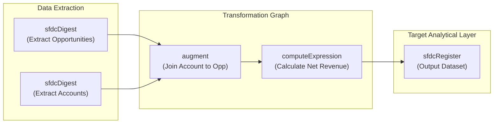

## Architectural Overview

The `WaveDataflow` metadata type represents an extract, transform, and load (ETL) data pipeline in CRM Analytics (formerly Tableau CRM). Within large-scale analytics architectures, dataflows extract data from standard and custom Salesforce objects (`sfdcDigest`), combine disparate data streams through left and cross joins (`augment`), calculate custom business logic (`computeExpression`), and register final high-performance analytical datasets (`sfdcRegister`).

From an architectural standpoint, a `WaveDataflow` is maintained in version control as a paired set of files: an XML metadata wrapper specifying high-level configuration and a JSON document containing a Directed Acyclic Graph (DAG) of processing transformations.



Although modern CRM Analytics developments frequently leverage `WaveRecipe` (Data Prep 3.0), hundreds of mission-critical enterprise systems still rely on `WaveDataflow` for complex, high-throughput batch transformations. Understanding its deployment mechanics is essential for maintaining enterprise analytical integrity.

---

## Directory and File Suffix

In Salesforce DX source format, a `WaveDataflow` is organized in the `wave/` directory with two paired artifacts:

- **JSON Transformation Payload**: `force-app/main/default/wave/<DataflowName>.wdf`
- **Metadata Envelope File**: `force-app/main/default/wave/<DataflowName>.wdf-meta.xml`

```text
force-app/
└── main/
    └── default/
        └── wave/
            ├── Core_Financial_Dataflow.wdf
            └── Core_Financial_Dataflow.wdf-meta.xml
```

---

## Key Metadata Fields

The `.wdf-meta.xml` descriptor contains administrative properties governing the dataflow container:

| Field Name | Type | Required | Description |
|---|---|---|---|
| `masterLabel` | `string` | Yes | The human-readable label displayed in Data Manager and Analytics Studio. |
| `description` | `string` | No | Architectural summary of the dataflow, its source systems, and output datasets. |
| `dataflowType` | `string` | No | Denotes the dataflow execution classification, typically `Dataflow` or `System`. |

The `.wdf` JSON payload houses the declarative node structure:
- `sfdcDigest`: Specifies the source object, extracted fields, and SOQL filter conditions.
- `augment`: Defines left and right keys for combining tabular streams.
- `computeExpression`: Generates derived dimensions and numeric measures using SAQL expressions.
- `filter`: Discards records that do not meet explicit operational criteria.
- `sfdcRegister`: Registers the transformed data into a published `WaveDataset`.

---

## Declarative XML and JSON Examples

### Metadata XML Descriptor (`wave/Core_Financial_Dataflow.wdf-meta.xml`)

```xml
<?xml version="1.0" encoding="UTF-8"?>
<WaveDataflow xmlns="http://soap.sforce.com/2006/04/metadata">
    <description>Extracts Opportunity and Account data, calculates net margins, and registers core financial metrics.</description>
    <masterLabel>Core Financial Dataflow</masterLabel>
</WaveDataflow>
```

### Transformation JSON Graph (`wave/Core_Financial_Dataflow.wdf`)

```json
{
  "Extract_Opportunities": {
    "action": "sfdcDigest",
    "parameters": {
      "object": "Opportunity",
      "fields": [
        { "name": "Id" },
        { "name": "AccountId" },
        { "name": "Amount" },
        { "name": "StageName" },
        { "name": "CloseDate" }
      ]
    }
  },
  "Extract_Accounts": {
    "action": "sfdcDigest",
    "parameters": {
      "object": "Account",
      "fields": [
        { "name": "Id" },
        { "name": "Name" },
        { "name": "Industry" },
        { "name": "BillingCountry" }
      ]
    }
  },
  "Join_Account_To_Opp": {
    "action": "augment",
    "parameters": {
      "left": "Extract_Opportunities",
      "left_key": [ "AccountId" ],
      "relationship": "Account",
      "right": "Extract_Accounts",
      "right_key": [ "Id" ],
      "right_select": [ "Name", "Industry", "BillingCountry" ]
    }
  },
  "Register_Financial_Dataset": {
    "action": "sfdcRegister",
    "parameters": {
      "source": "Join_Account_To_Opp",
      "name": "Financial_Executive_Pipeline",
      "alias": "financial_executive_pipeline"
    }
  }
}
```

### Manifest Definition (`package.xml`)

```xml
<?xml version="1.0" encoding="UTF-8"?>
<Package xmlns="http://soap.sforce.com/2006/04/metadata">
    <types>
        <members>Core_Financial_Dataflow</members>
        <name>WaveDataflow</name>
    </types>
    <version>68.0</version>
</Package>
```

---

## Retrieval and Deployment

### Retrieving Dataflows via Salesforce CLI

Retrieve the metadata envelope and transformation JSON into your local project workspace:

```bash
# Retrieve a specific dataflow component
sf project retrieve start --metadata "WaveDataflow:Core_Financial_Dataflow"

# Retrieve all dataflows in the target organization
sf project retrieve start --metadata "WaveDataflow"
```

### Validating and Deploying across Pipelines

To deploy the dataflow to your staging or production environments:

```bash
# Validate dataflow syntax without applying changes
sf project deploy validate \
    --metadata "WaveDataflow:Core_Financial_Dataflow" \
    --target-org staging-sandbox

# Deploy the dataflow directly to the target org
sf project deploy start \
    --metadata "WaveDataflow:Core_Financial_Dataflow" \
    --target-org production-org
```

### Inspecting Dataflows with the Tooling API

Enterprise CI/CD scripts can verify deployed dataflows by querying the `Dataflow` Tooling API entity:

```bash
sf data query --use-tooling-api --query \
    "SELECT Id, DeveloperName, MasterLabel, DataflowType, CreatedDate, LastModifiedDate FROM Dataflow WHERE DeveloperName = 'Core_Financial_Dataflow'"
```

---

## Architect Deployment Best Practices & Gotchas

> [!TIP]
> **Verify Field-Level Security for the Analytics Integration User:** Every field referenced inside `sfdcDigest` extraction nodes must be accessible to the **Analytics Cloud Integration User** profile. If a custom field is not granted read access, deployment or runtime execution will fail with an authorization exception.

> [!WARNING]
> **Deployment Does Not Run the Pipeline:** Deploying a `WaveDataflow` through the Metadata API only updates the pipeline definition; it does not trigger an execution run. Any dashboards relying on new output fields will reflect stale schemas until a post-deployment script initiates a dataflow job via the Analytics REST API.

> [!NOTE]
> **Dataflow vs. Recipe Migration Roadmaps:** Salesforce actively enhances Data Prep (`WaveRecipe`) while keeping `WaveDataflow` in maintenance mode. When architecting new ETL streams, build using recipes. For existing dataflows, consider using the built-in Dataflow-to-Recipe conversion tool prior to major refactoring.
