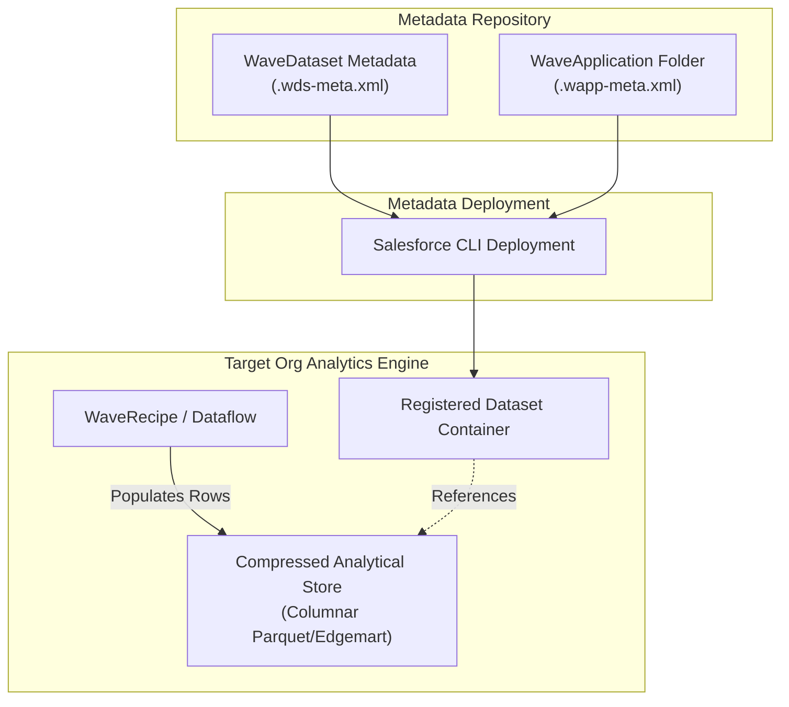

## Architectural Overview

The `WaveDataset` metadata type represents a curated analytical data container within CRM Analytics. Datasets in CRM Analytics are highly compressed, column-oriented inverted-index data stores engineered to execute complex multi-dimensional queries across millions of records in sub-second response times.

From a metadata and DevOps architecture standpoint, a `WaveDataset` component specifies the architectural container for the dataset: its developer name, user-facing label, organizational application folder, and optional templating bindings. It does **not** contain the physical data rows or edgemart files. Instead, the data layer is populated asynchronously through data sync routines, recipes (`WaveRecipe`), dataflows (`WaveDataflow`), or the external data upload API.



Architects managing multi-org release strategies must understand this metadata versus data boundary to avoid creating empty dataset shells in test environments that cause dashboard queries to fail.

---

## Directory and File Suffix

In Salesforce DX project source structure, `WaveDataset` components reside in the `wave/` directory and use the `.wds-meta.xml` file suffix:

- **Source File Path**: `force-app/main/default/wave/<DatasetName>.wds-meta.xml`

```text
force-app/
└── main/
    └── default/
        └── wave/
            ├── Global_Sales_Metrics.wds-meta.xml
            └── Service_Operations_Store.wds-meta.xml
```

---

## Key Metadata Fields

The `.wds-meta.xml` XML manifest exposes the following configuration fields:

| Field Name | Type | Required | Description |
|---|---|---|---|
| `application` | `string` | Yes | The DeveloperName of the parent `WaveApplication` folder housing the dataset. |
| `masterLabel` | `string` | Yes | The human-readable title shown to analysts in Analytics Studio, Data Manager, and Lens builders. |
| `description` | `string` | No | Architectural documentation describing the dataset purpose, grain, and source systems. |
| `templateAssetSourceName` | `string` | No | Identifier linking the dataset back to its origin `WaveTemplateBundle` when generated from an app template. |

---

## Declarative XML Examples

### Complete WaveDataset Descriptor (`wave/Global_Sales_Metrics.wds-meta.xml`)

```xml
<?xml version="1.0" encoding="UTF-8"?>
<WaveDataset xmlns="http://soap.sforce.com/2006/04/metadata">
    <application>Global_Commercial_Intelligence</application>
    <description>Consolidated global sales dataset aggregating opportunity history, lead progression, and quota attainment.</description>
    <masterLabel>Global Sales Metrics</masterLabel>
</WaveDataset>
```

### Manifest Definition (`package.xml`)

```xml
<?xml version="1.0" encoding="UTF-8"?>
<Package xmlns="http://soap.sforce.com/2006/04/metadata">
    <types>
        <members>Global_Commercial_Intelligence</members>
        <name>WaveApplication</name>
    </types>
    <types>
        <members>Global_Sales_Metrics</members>
        <name>WaveDataset</name>
    </types>
    <version>68.0</version>
</Package>
```

---

## Retrieval and Deployment

### Retrieving Datasets with Salesforce CLI

Retrieve the dataset metadata descriptor from your connected development environment:

```bash
# Retrieve a single WaveDataset definition
sf project retrieve start --metadata "WaveDataset:Global_Sales_Metrics"

# Retrieve all datasets alongside their parent application containers
sf project retrieve start --metadata "WaveApplication,WaveDataset"
```

### Deploying across Release Pipelines

Deploy the dataset metadata into your testing sandboxes or production org:

```bash
# Validate dataset deployment in staging
sf project deploy validate \
    --metadata "WaveDataset:Global_Sales_Metrics" \
    --target-org staging-sandbox

# Deploy the dataset into production
sf project deploy start \
    --metadata "WaveDataset:Global_Sales_Metrics" \
    --target-org production-org
```

### Querying Dataset Records via Tooling API

Inspect deployed dataset definitions and identify internal storage identifiers using the Tooling API:

```bash
sf data query --use-tooling-api --query \
    "SELECT Id, DeveloperName, MasterLabel, FolderId, CreatedDate, LastModifiedDate FROM WaveDataset WHERE DeveloperName = 'Global_Sales_Metrics'"
```

---

## Architect Deployment Best Practices & Gotchas

> [!NOTE]
> **Data Population Is an Orchestrated Step:** Deploying a `WaveDataset` creates the metadata placeholder in the CRM Analytics repository. To render data in lenses or dashboards, an automated CI/CD pipeline or deployment runbook must trigger the associated `WaveRecipe` or `WaveDataflow` via the Analytics REST API.

> [!TIP]
> **Parent Folder Pre-requisites:** The `WaveDataset` schema strictly requires the `application` field to resolve to an existing `WaveApplication`. If the app folder does not exist in the target org, deployment fails with a `Missing parent application` exception. Bundle the parent folder in the deployment manifest.

> [!WARNING]
> **Extended Metadata Synchronization:** When customizing dimension labels, measure formats, or conditional coloring, maintain the associated `WaveXmd` component in source control. Failing to deploy the corresponding `WaveXmd` file will leave the dataset with default, unformatted field names.
