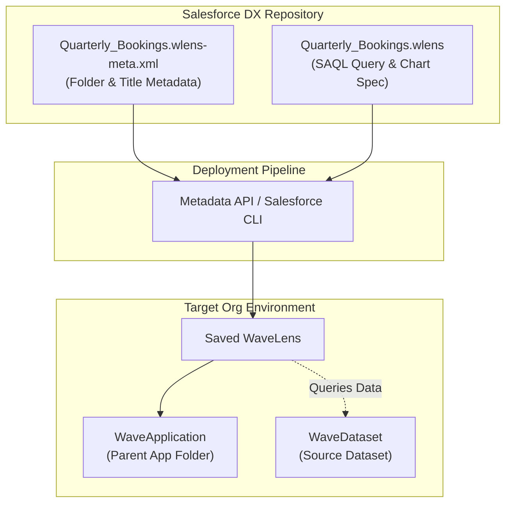

## Architectural Overview

The `WaveLens` metadata type represents a saved visualization or exploratory query on a CRM Analytics dataset. In the analytical lifecycle, lenses serve as targeted data investigation assets—allowing data scientists, business analysts, and executives to slice, dice, group, and visualize metrics before incorporating them into comprehensive multi-widget dashboards (`WaveDashboard`).

Architecturally, a `WaveLens` decouples its administrative metadata envelope from its exploratory query state. The metadata XML file establishes folder ownership and naming conventions, while the companion JSON file encapsulates query logic (SAQL strings or compact form parameters), measure aggregations, grouping dimensions, and visual chart rendering properties.



For release architects, understanding how `WaveLens` references target datasets and application folders ensures smooth transitions between developer scratch orgs, sandboxes, and production environments.

---

## Directory and File Suffix

In Salesforce DX projects, `WaveLens` components are stored under the `wave/` directory as paired files:

- **Visualization and Query JSON**: `force-app/main/default/wave/<LensName>.wlens`
- **Metadata Configuration File**: `force-app/main/default/wave/<LensName>.wlens-meta.xml`

```text
force-app/
└── main/
    └── default/
        └── wave/
            ├── Quarterly_Bookings_Trend.wlens
            └── Quarterly_Bookings_Trend.wlens-meta.xml
```

---

## Key Metadata Fields

The `.wlens-meta.xml` metadata descriptor governs administrative properties:

| Field Name | Type | Required | Description |
|---|---|---|---|
| `application` | `string` | Yes | The DeveloperName of the parent `WaveApplication` folder storing this lens. |
| `masterLabel` | `string` | Yes | Human-readable title displayed in Analytics Studio and search results. |
| `description` | `string` | No | Functional summary detailing the query objective and business scope. |
| `datasets` | `string[]` | Yes | The developer name(s) of the underlying `WaveDataset` queried by this lens. |
| `visualizationType` | `string` | No | Default visual presentation format (such as `hbar`, `line`, `pie`, or `valuestable`). |

The companion `.wlens` file contains the complete JSON payload defining:
- `state.query`: The SAQL string or compact form query specifying filters, groups, and aggregations.
- `state.visualizationType`: Chart presentation properties and axis formatting.
- `state.layout`: Layout sizing and legend positioning.

---

## Declarative XML and JSON Examples

### Metadata XML Descriptor (`wave/Quarterly_Bookings_Trend.wlens-meta.xml`)

```xml
<?xml version="1.0" encoding="UTF-8"?>
<WaveLens xmlns="http://soap.sforce.com/2006/04/metadata">
    <application>Executive_Commercial_Hub</application>
    <datasets>
        <dataset>Global_Sales_Metrics</dataset>
    </datasets>
    <description>Quarterly comparison of closed-won bookings segmented by global geographic region.</description>
    <masterLabel>Quarterly Bookings Trend</masterLabel>
    <visualizationType>hbar</visualizationType>
</WaveLens>
```

### Accompanying Lens Definition (`wave/Quarterly_Bookings_Trend.wlens`)

```json
{
  "version": "68.0",
  "state": {
    "query": {
      "measures": [["sum", "Amount"]],
      "groups": ["FiscalQuarter", "Region"],
      "filters": [
        ["StageName", ["Closed Won"], "in"]
      ]
    },
    "visualizationType": "hbar",
    "parameters": {
      "title": "Closed Won Bookings by Region",
      "legend": {
        "show": true,
        "position": "right"
      },
      "axisMode": "grouped"
    }
  },
  "datasets": [
    {
      "name": "Global_Sales_Metrics"
    }
  ]
}
```

### Manifest Definition (`package.xml`)

```xml
<?xml version="1.0" encoding="UTF-8"?>
<Package xmlns="http://soap.sforce.com/2006/04/metadata">
    <types>
        <members>Global_Sales_Metrics</members>
        <name>WaveDataset</name>
    </types>
    <types>
        <members>Quarterly_Bookings_Trend</members>
        <name>WaveLens</name>
    </types>
    <version>68.0</version>
</Package>
```

---

## Retrieval and Deployment

### Retrieving Lenses via Salesforce CLI

Retrieve the lens query definition and metadata descriptor together:

```bash
# Retrieve a single lens component
sf project retrieve start --metadata "WaveLens:Quarterly_Bookings_Trend"

# Retrieve all lenses and datasets within the project
sf project retrieve start --metadata "WaveDataset,WaveLens"
```

### Validating and Deploying across Orgs

Deploy lenses into target testing or production orgs:

```bash
# Validate deployment without applying changes
sf project deploy validate \
    --metadata "WaveLens:Quarterly_Bookings_Trend" \
    --target-org uat-sandbox

# Execute deployment to target org
sf project deploy start \
    --metadata "WaveLens:Quarterly_Bookings_Trend" \
    --target-org production-org
```

### Inspecting Lens Records with Tooling API

Enterprise CI/CD systems can verify deployed lenses using Tooling API queries:

```bash
sf data query --use-tooling-api --query \
    "SELECT Id, DeveloperName, MasterLabel, FolderId, VisualizationType, CreatedDate FROM Lens WHERE DeveloperName = 'Quarterly_Bookings_Trend'"
```

---

## Architect Deployment Best Practices & Gotchas

> [!TIP]
> **Keep Dataset References Environment-Agnostic:** Ensure the `datasets` element in both `.wlens` and `.wlens-meta.xml` uses the dataset developer name (`Global_Sales_Metrics`) rather than an org-specific dataset ID (`0Fb...`). This ensures zero friction during automated pipeline promotions.

> [!WARNING]
> **Upstream Schema Alignment:** A `WaveLens` deployment will fail or produce runtime errors if the underlying `WaveDataset` does not contain the exact dimension or measure fields defined in the lens query. Ensure recipe changes are executed before lens verification tests run.

> [!NOTE]
> **Lens to Dashboard Migration:** When a user finalizes an exploratory lens in Analytics Studio, they frequently clip it into a dashboard. Note that clipping creates a distinct step within the target `WaveDashboard` JSON, decoupling it from future changes made to the original `WaveLens` component.
