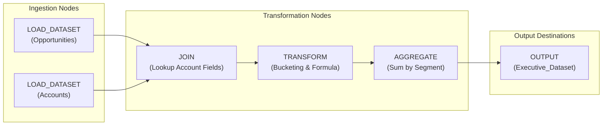

## Architectural Overview

The `WaveRecipe` metadata type represents a visual Data Prep 3.0 transformation pipeline within CRM Analytics. As Salesforce's flagship data integration framework for analytics, Data Prep recipes enable data engineers to build self-documenting transformation directed acyclic graphs (DAGs). These pipelines clean, aggregate, join, window, predict, and output large data volumes directly to CRM Analytics datasets, Salesforce core objects, or external data lakes.

Architecturally, `WaveRecipe` metadata decouples the pipeline container settings from the underlying processing graph. The XML descriptor file defines metadata ownership, labels, and target specifications, while the companion `.wdpr` file holds the rich JSON graph detailing transformation nodes, connection edges, visual canvas coordinates, and field-level mappings.



Because `WaveRecipe` replaces legacy `WaveDataflow` implementations for modern enterprise designs, establishing automated CI/CD validation for recipes is vital to preventing pipeline regressions and schema mismatches.

---

## Directory and File Suffix

In Salesforce DX source format, `WaveRecipe` artifacts are stored in the `wave/` directory as a multi-file bundle:

- **Data Prep JSON Graph**: `force-app/main/default/wave/<RecipeName>.wdpr`
- **Metadata Manifest File**: `force-app/main/default/wave/<RecipeName>.wdpr-meta.xml`

```text
force-app/
└── main/
    └── default/
        └── wave/
            ├── Global_Pipeline_Transformation.wdpr
            └── Global_Pipeline_Transformation.wdpr-meta.xml
```

---

## Key Metadata Fields

The `.wdpr-meta.xml` XML manifest exposes the following administrative fields:

| Field Name | Type | Required | Description |
|---|---|---|---|
| `masterLabel` | `string` | Yes | Human-readable title displayed in Data Manager and recipe schedules. |
| `description` | `string` | No | Architectural overview explaining data sources, transformation stages, and consumer datasets. |
| `dataflowType` | `string` | No | Internal classification identifier, typically set to `Recipe`. |
| `format` | `string` | No | Engine execution format (such as `R3` for Data Prep 3.0). |
| `securityURL` | `string` | No | URL specifying security predicate endpoints or custom security logic when applicable. |

The companion `.wdpr` file encapsulates:
- `nodes`: Dictionary of transformation nodes (`LOAD_DATASET`, `JOIN`, `TRANSFORM`, `AGGREGATE`, `FILTER`, `OUTPUT`).
- `ui`: Canvas layout information, coordinates, and visual node grouping.
- `parameters`: Execution parameters and writeback targets.

---

## Declarative XML and JSON Examples

### Metadata XML Descriptor (`wave/Global_Pipeline_Transformation.wdpr-meta.xml`)

```xml
<?xml version="1.0" encoding="UTF-8"?>
<WaveRecipe xmlns="http://soap.sforce.com/2006/04/metadata">
    <dataflowType>Recipe</dataflowType>
    <description>Modern Data Prep recipe combining opportunities and account tiers into high-performance executive datasets.</description>
    <format>R3</format>
    <masterLabel>Global Pipeline Transformation</masterLabel>
</WaveRecipe>
```

### Accompanying Data Prep JSON Graph (`wave/Global_Pipeline_Transformation.wdpr`)

```json
{
  "version": "68.0",
  "nodes": {
    "LOAD_OPP": {
      "action": "load",
      "sources": [],
      "parameters": {
        "dataset": {
          "type": "analyticsDataset",
          "sourceObjectName": "Opportunity_Analytics_Dataset"
        },
        "fields": ["Id", "AccountId", "Amount", "StageName", "CloseDate"]
      }
    },
    "FILTER_WON": {
      "action": "filter",
      "sources": ["LOAD_OPP"],
      "parameters": {
        "filterExpressions": [
          {
            "field": "StageName",
            "operands": ["Closed Won"],
            "operator": "EQUAL"
          }
        ]
      }
    },
    "SAVE_METRICS": {
      "action": "save",
      "sources": ["FILTER_WON"],
      "parameters": {
        "dataset": {
          "type": "analyticsDataset",
          "label": "Closed Won Revenue Metrics",
          "name": "Closed_Won_Revenue_Metrics"
        }
      }
    }
  },
  "ui": {
    "nodes": {
      "LOAD_OPP": { "label": "Load Opportunities", "type": "LOAD_DATASET", "top": 100, "left": 100 },
      "FILTER_WON": { "label": "Filter Closed Won", "type": "FILTER", "top": 100, "left": 250 },
      "SAVE_METRICS": { "label": "Save Revenue Dataset", "type": "OUTPUT", "top": 100, "left": 400 }
    }
  }
}
```

### Manifest Definition (`package.xml`)

```xml
<?xml version="1.0" encoding="UTF-8"?>
<Package xmlns="http://soap.sforce.com/2006/04/metadata">
    <types>
        <members>Global_Pipeline_Transformation</members>
        <name>WaveRecipe</name>
    </types>
    <version>68.0</version>
</Package>
```

---

## Retrieval and Deployment

### Retrieving Recipes with Salesforce CLI

Retrieve the recipe metadata and its JSON graph together into your workspace:

```bash
# Retrieve a specific recipe
sf project retrieve start --metadata "WaveRecipe:Global_Pipeline_Transformation"

# Retrieve all recipes in the connected org
sf project retrieve start --metadata "WaveRecipe"
```

### Deploying Recipes across Environments

Validate and deploy your recipes across development, testing, and production orgs:

```bash
# Validate recipe syntax against target sandbox
sf project deploy validate \
    --metadata "WaveRecipe:Global_Pipeline_Transformation" \
    --target-org uat-sandbox

# Deploy the recipe to production
sf project deploy start \
    --metadata "WaveRecipe:Global_Pipeline_Transformation" \
    --target-org production-org
```

### Inspecting Recipes via Tooling API

Enterprise pipelines can verify deployed recipe versions and runtime IDs using the Tooling API:

```bash
sf data query --use-tooling-api --query \
    "SELECT Id, DeveloperName, MasterLabel, DataflowType, Format, CreatedDate, LastModifiedDate FROM Recipe WHERE DeveloperName = 'Global_Pipeline_Transformation'"
```

---

## Architect Deployment Best Practices & Gotchas

> [!TIP]
> **Source Sync Pre-requisite:** If your recipe loads data from synced Salesforce objects via the `SFDC_LOCAL` connector, ensure those object and field syncs are actively configured and synchronized in the target org before running the recipe.

> [!WARNING]
> **Field Dependency Validation:** When a recipe references custom fields in formulas or filter nodes, those fields must exist in the target org. Always deploy dependent `CustomField` components before or alongside `WaveRecipe` metadata.

> [!NOTE]
> **Automating Post-Deployment Runs:** Deploying a `WaveRecipe` updates its logic, but the target dataset remains unrefreshed. Build an automated webhook or CI/CD script that uses the Analytics REST API (`/services/data/v68.0/wave/recipes/<id>/executions`) to trigger a recipe run immediately following successful deployment.
