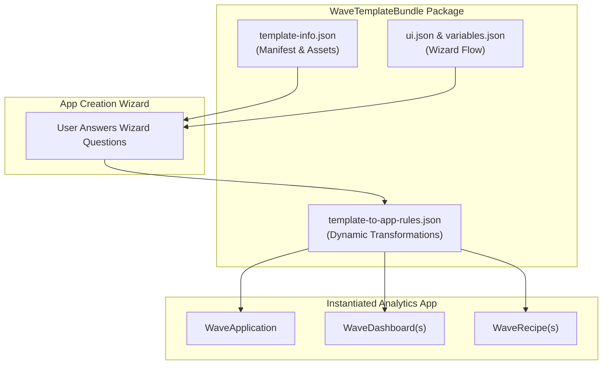

## Architectural Overview

The `WaveTemplateBundle` metadata type represents a CRM Analytics template bundle. In enterprise and ISV architecture, templating is the gold standard for distributing complete, repeatable analytics solutions. A template bundle packages an entire suite of analytical assets—including dashboards, lenses, recipes, dataflows, extended metadata (XMD), and folders—into a reusable blueprint that users or automated processes can instantiate as personalized analytics applications.

Architecturally, `WaveTemplateBundle` is a directory-based bundle rather than a single XML file. It encapsulates user configuration wizards, dynamic variable substitution rules, conditional asset creation, and schema mapping. When an end-user creates an application from a template, the template engine executes the bundle's rules engine to alter queries, filter conditions, and dashboard widgets based on the subscriber org's schema and configuration answers.



Mastering `WaveTemplateBundle` allows enterprise architects to build multi-tenant analytics frameworks, distributing standardized KPI suites across multiple subsidiary orgs with zero manual configuration.

---

## Directory and File Suffix

Unlike single-file metadata types, `WaveTemplateBundle` is organized as a structured bundle folder located under `waveTemplates/`:

- **Bundle Directory**: `force-app/main/default/waveTemplates/<TemplateName>/`

```text
force-app/
└── main/
    └── default/
        └── waveTemplates/
            └── Commercial_Operations_Template/
                ├── template-info.json
                ├── ui.json
                ├── variables.json
                ├── template-to-app-rules.json
                ├── dashboards/
                │   └── Executive_Summary.json
                └── recipes/
                    └── Commercial_Data_Prep.json
```

---

## Key Metadata Files and JSON Schemas

The bundle directory contains several coordinated JSON specifications:

| File Name | Purpose | Description |
|---|---|---|
| `template-info.json` | Master Manifest | Defines template label, description, version, tags, icons, and references to packaged assets. |
| `ui.json` | Wizard UI Structure | Configures the visual wizard pages, question sections, navigation order, and widget inputs. |
| `variables.json` | Variable Definitions | Declares the parameters collected from users during the wizard (data types, defaults, choices). |
| `template-to-app-rules.json` | Rules Engine | Defines declarative heuristics that dynamically alter dashboards, recipes, and datasets based on variable values. |

---

## Declarative Configuration Examples

### Template Manifest (`waveTemplates/Commercial_Operations_Template/template-info.json`)

```json
{
  "name": "Commercial_Operations_Template",
  "label": "Commercial Operations Template",
  "description": "Enterprise commercial operations analytics blueprint including revenue pacing and pipeline velocity.",
  "assetVersion": 68.0,
  "variableDefinition": "variables.json",
  "uiDefinition": "ui.json",
  "rules": [
    {
      "type": "templateToApp",
      "file": "template-to-app-rules.json"
    }
  ],
  "dashboards": [
    {
      "label": "Commercial Executive Summary",
      "name": "Commercial_Executive_Summary",
      "file": "dashboards/Commercial_Executive_Summary.json"
    }
  ]
}
```

### Variable Declaration (`waveTemplates/Commercial_Operations_Template/variables.json`)

```json
{
  "IncludeRenewalPipeline": {
    "label": "Include Contract Renewals in Pipeline?",
    "description": "Select true if your organization forecasts contract renewals alongside new business opportunities.",
    "defaultValue": true,
    "required": true,
    "variableType": {
      "type": "BooleanType"
    }
  }
}
```

### Manifest Definition (`package.xml`)

```xml
<?xml version="1.0" encoding="UTF-8"?>
<Package xmlns="http://soap.sforce.com/2006/04/metadata">
    <types>
        <members>Commercial_Operations_Template</members>
        <name>WaveTemplateBundle</name>
    </types>
    <version>68.0</version>
</Package>
```

---

## Retrieval and Deployment

### Retrieving Template Bundles via Salesforce CLI

Retrieve the full bundle directory with all JSON files and referenced assets:

```bash
# Retrieve a specific WaveTemplateBundle
sf project retrieve start --metadata "WaveTemplateBundle:Commercial_Operations_Template"

# Retrieve all template bundles in the target org
sf project retrieve start --metadata "WaveTemplateBundle"
```

### Deploying across Enterprise Release Pipelines

Deploy template bundles to packaging orgs, testing sandboxes, or production environments:

```bash
# Validate template bundle deployment
sf project deploy validate \
    --metadata "WaveTemplateBundle:Commercial_Operations_Template" \
    --target-org packaging-org

# Deploy the bundle to production
sf project deploy start \
    --metadata "WaveTemplateBundle:Commercial_Operations_Template" \
    --target-org production-org
```

### Inspecting Templates via Analytics REST API

You can inspect installed templates and their bundle configurations using the Analytics REST API endpoint:

```bash
sf api request rest "/services/data/v68.0/wave/templates"
```

---

## Architect Deployment Best Practices & Gotchas

> [!TIP]
> **Use Rules for Optional Object Dependencies:** Enterprise orgs often customize CRM schemas. By leveraging `template-to-app-rules.json`, you can inspect whether optional objects (such as `Order` or `Quote`) exist in the subscriber org and conditionally exclude dependent dashboard widgets instead of failing app creation.

> [!WARNING]
> **Asset References Must Match Directory Files:** In `template-info.json`, all referenced dashboard, recipe, and lens file paths must strictly match the actual files present inside the bundle folder. Missing or mismatched file paths will cause immediate deployment termination.

> [!NOTE]
> **Managed Packaging Considerations:** When distributing `WaveTemplateBundle` in a 2GP managed package, the template acts as an immutable factory. When a subscriber creates an app from the template, the generated assets become customer-owned copies that can be updated independently without breaking package upgradeability.
