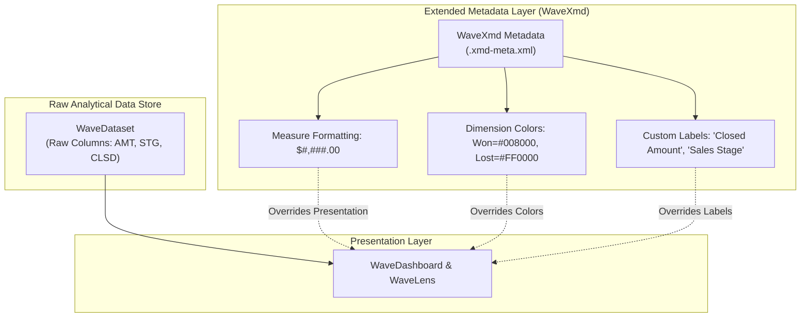

## Architectural Overview

The `WaveXmd` metadata type represents Extended Metadata (XMD) for a CRM Analytics dataset. In enterprise reporting, raw dataset columns generated from ETL processes frequently retain technical database aliases, inconsistent currency symbols, or arbitrary default colors. `WaveXmd` provides an abstraction layer that governs how dataset fields are presented to end-users without altering the underlying parquet or edgemart data store.

Architecturally, `WaveXmd` decouples data processing from data presentation. While recipes (`WaveRecipe`) and dataflows (`WaveDataflow`) focus on record joining and data transformation, `WaveXmd` controls human-centric presentation attributes: formatting measures with currency prefixes, establishing corporate brand color palettes for dimension picklist values, localizing field labels, and hiding system surrogate keys from the Lens query builder.



By maintaining `WaveXmd` definitions in source control, DevOps teams ensure that corporate design systems and executive visual standards persist across environment refreshes and CI/CD deployments.

---

## Directory and File Suffix

In Salesforce DX project structure, `WaveXmd` components are located in the `wave/` directory and use the `.xmd-meta.xml` file suffix, named after the associated dataset:

- **Source File Path**: `force-app/main/default/wave/<DatasetName>.xmd-meta.xml`

```text
force-app/
└── main/
    └── default/
        └── wave/
            ├── Global_Sales_Metrics.wds-meta.xml
            └── Global_Sales_Metrics.xmd-meta.xml
```

---

## Key Metadata Fields

The root `<WaveXmd>` element encapsulates sub-arrays configuring individual field categories:

| Sub-Element | Type | Description |
|---|---|---|
| `dimensions` | `WaveXmdDimension[]` | Configures dimension fields, friendly labels, member value color maps, and visibility flags. |
| `measures` | `WaveXmdMeasure[]` | Controls numeric measure formatting, decimal precision, currency symbols, and units. |
| `dates` | `WaveXmdDate[]` | Customizes date grouping labels and fiscal calendar display formats. |
| `derivedDimensions` | `WaveXmdDimension[]` | Formats virtual dimensions created dynamically in dashboard step queries. |
| `derivedMeasures` | `WaveXmdMeasure[]` | Formats calculated measures and runtime formula outputs. |

### Dimension & Measure Sub-Properties

- `field`: The exact API name of the dataset field being customized.
- `label`: The customer-friendly field label shown in Analytics Studio.
- `format`: For measures, specifies the number format pattern (such as `"$#,##0.00"`).
- `members`: For dimensions, defines specific picklist value overrides (`member`, `label`, `color`).
- `isDerived`: Boolean indicating whether the field is derived at runtime.

---

## Declarative XML Examples

### Complete Extended Metadata File (`wave/Global_Sales_Metrics.xmd-meta.xml`)

```xml
<?xml version="1.0" encoding="UTF-8"?>
<WaveXmd xmlns="http://soap.sforce.com/2006/04/metadata">
    <dataset>Global_Sales_Metrics</dataset>
    <dimensions>
        <field>StageName</field>
        <isDerived>false</isDerived>
        <label>Sales Pipeline Stage</label>
        <members>
            <color>#2E844A</color>
            <label>Closed and Booked</label>
            <member>Closed Won</member>
        </members>
        <members>
            <color>#BA0517</color>
            <label>Opportunity Lost</label>
            <member>Closed Lost</member>
        </members>
    </dimensions>
    <measures>
        <field>Amount</field>
        <formatDecimalSeparator>.</formatDecimalSeparator>
        <formatThousandsSeparator>,</formatThousandsSeparator>
        <isDerived>false</isDerived>
        <label>Booked Revenue</label>
        <formatCustomFormat>[&quot;$#,##0.00&quot;,1]</formatCustomFormat>
    </measures>
    <type>Main</type>
</WaveXmd>
```

### Manifest Definition (`package.xml`)

```xml
<?xml version="1.0" encoding="UTF-8"?>
<Package xmlns="http://soap.sforce.com/2006/04/metadata">
    <types>
        <members>Global_Sales_Metrics</members>
        <name>WaveDataset</name>
    </types>
    <types>
        <members>Global_Sales_Metrics</members>
        <name>WaveXmd</name>
    </types>
    <version>68.0</version>
</Package>
```

---

## Retrieval and Deployment

### Retrieving Extended Metadata via Salesforce CLI

Retrieve the dataset extended metadata along with its parent dataset:

```bash
# Retrieve a specific WaveXmd component
sf project retrieve start --metadata "WaveXmd:Global_Sales_Metrics"

# Retrieve all datasets and their XMD configurations
sf project retrieve start --metadata "WaveDataset,WaveXmd"
```

### Deploying across Release Pipelines

Deploy the updated extended metadata definitions into your sandboxes or production org:

```bash
# Validate XMD syntax against target org
sf project deploy validate \
    --metadata "WaveXmd:Global_Sales_Metrics" \
    --target-org staging-sandbox

# Deploy the XMD configuration
sf project deploy start \
    --metadata "WaveXmd:Global_Sales_Metrics" \
    --target-org production-org
```

---

## Architect Deployment Best Practices & Gotchas

> [!TIP]
> **Avoid Re-running Heavy Pipelines for Cosmetic Adjustments:** When business stakeholders request changes to field labels, currency symbols, or chart color schemes, update `WaveXmd` instead of editing the recipe. XMD deployments apply immediately without requiring time-consuming dataset recomputation.

> [!WARNING]
> **Dataset Name Alignment:** The metadata member name of a `WaveXmd` component must exactly match the `WaveDataset` developer name. A mismatch in file naming or the `<dataset>` tag will cause the deployment to fail with an unmatched reference error.

> [!NOTE]
> **System XMD vs. User XMD:** CRM Analytics maintains two XMD layers: System XMD (generated automatically by dataflows/recipes) and User XMD (authored via UI or Metadata API). User XMD always takes precedence over System XMD during dashboard query rendering.
