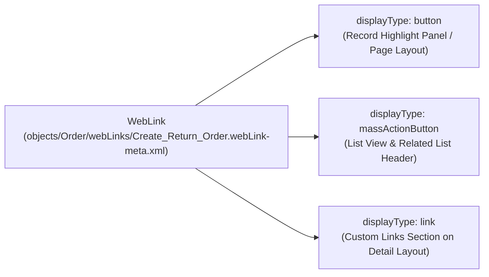

## Why the `WebLink` Metadata Type Still Matters

While [QuickAction](/docs/metadata/quick-action-metadata-type/) handles modal LWC and Screen Flow actions on record pages, **`WebLink`** (`objects/<ObjectName>/webLinks/<Name>.webLink-meta.xml`) remains essential for three high-value patterns in Lightning Experience:

1. **List View & Related List Mass Action Buttons (`massActionButton`):** Launching an Autolaunched/Screen Flow URL (`/flow/Mass_Approve_Orders?retURL=...`) or a Visualforce `StandardSetController` page with selected checkboxes (`requireRowSelection = true`).
2. **Native Record Creation with Default Field Values (`/lightning/o/Order/new?defaultFieldValues=...`):** Opening the standard Lightning record creation modal pre-populated with parent field values without writing custom code.
3. **External Deep Links (`link` / `button`):** Launching external ERP, shipping tracker, or DocuSign endpoints with merge fields (`{!Account.ERP_Customer_ID__c}`).



---

## Key Metadata Fields on `WebLink`

| Field | Type | Required | Description |
|---|---|---|---|
| `displayType` | `WebLinkDisplayType` | Yes | `button` (Detail Page Button), `link` (Detail Page Link), or `massActionButton` (List View Button). |
| `linkType` | `WebLinkType` | Yes | `url` (URL redirect), `page` (Visualforce `ApexPage`), `sControl` (legacy), or `javascript` (Classic only). |
| `openType` | `WebLinkWindowType` | Yes | `newWindow`, `sidebar`, `noSidebar`, `replace`, or `onClickJavaScript`. |
| `availability` | `WebLinkAvailability` | Yes | `online` or `offline`. |
| `encodingKey` | `Encoding` | Yes | Character encoding for URL parameters (typically `UTF-8`). |
| `url` | `string` | Conditional | The target URL or merge-field expression when `linkType` is `url`. |
| `page` | `string` | Conditional | Developer name of the [ApexPage](/docs/metadata/apex-page-metadata-type/) when `linkType` is `page`. |
| `requireRowSelection` | `boolean` | No | Only valid when `displayType` is `massActionButton`. Displays checkboxes on the List View or Related List so users can pass selected `ids` to the target page or flow. |
| ` masterLabel` | `string` | Yes | Button or link text displayed to users. |

---

## Real-World XML Example: Lightning Pre-Populated Record Creation Button

File: `force-app/main/default/objects/Opportunity/webLinks/New_Renewal_Quote.webLink-meta.xml`

```xml
<?xml version="1.0" encoding="UTF-8"?>
<WebLink xmlns="http://soap.sforce.com/2006/04/metadata">
    <fullName>New_Renewal_Quote</fullName>
    <availability>online</availability>
    <description>Opens standard Quote creation modal with pre-populated Opportunity and Account fields.</description>
    <displayType>button</displayType>
    <encodingKey>UTF-8</encodingKey>
    <linkType>url</linkType>
    <masterLabel>New Renewal Quote</masterLabel>
    <openType>replace</openType>
    <protected>false</protected>
    <url>/lightning/o/Quote/new?defaultFieldValues=OpportunityId={!Opportunity.Id},Name={!URLENCODE(Opportunity.Name + &apos; - Renewal&apos;)},ExpirationDate={!TEXT(TODAY() + 30)}</url>
</WebLink>
```

---

## Querying `WebLink` via SOQL & Tooling API

You can query `WebLink` in standard SOQL to audit legacy `javascript` buttons or hardcoded sandbox URLs across your org.

### 1. Audit Legacy OnClick JavaScript Buttons Blocking Lightning Migration

```sql
SELECT Id, PageOrSobjectType, Name, MasterLabel, DisplayType, LinkType, OpenType
FROM WebLink
WHERE NamespacePrefix = null
  AND (LinkType = 'javascript' OR OpenType = 'onClickJavaScript')
ORDER BY PageOrSobjectType, Name
```

### 2. Find WebLinks Containing Hardcoded Domains or URLs

```sql
SELECT Id, PageOrSobjectType, Name, MasterLabel, DisplayType, Url
FROM WebLink
WHERE NamespacePrefix = null
  AND LinkType = 'url'
ORDER BY PageOrSobjectType, Name
```

---

## Senior Architect Best Practices

- **Deploying a `WebLink` Does Not Automatically Show It on the UI:** Creating the `.webLink-meta.xml` file only registers the button on the object. To make it visible, you must also add it to the [Layout](/docs/metadata/layout-metadata-type/) (`customButtons`), the [FlexiPage](/docs/metadata/flexipage-metadata-type/) Dynamic Actions bar, or the object's Search Layout / List View button configuration (`searchLayouts.listViewButtons`).
- **Always Use `URLENCODE()` inside Merge Expressions:** If an Account or Opportunity name contains an ampersand (`AT&T`), an unencoded merge field inside `defaultFieldValues` will truncate the query string parameter.
