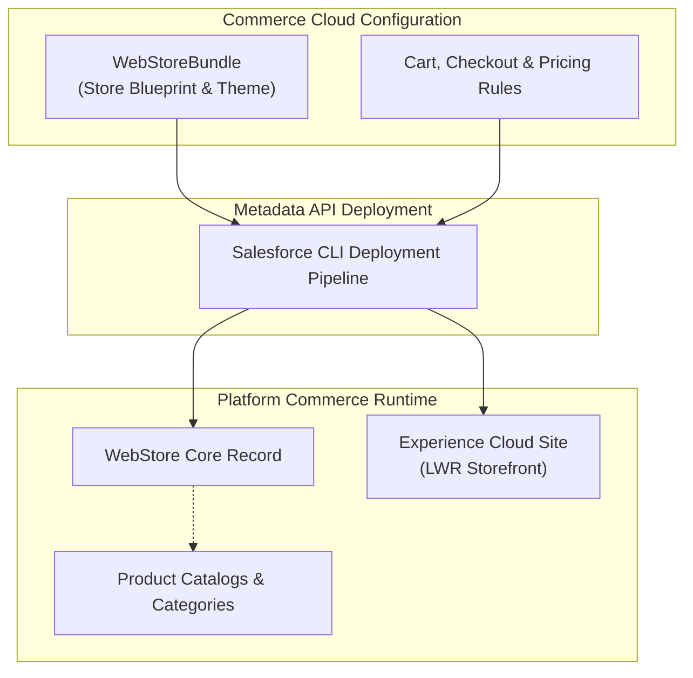

## Architectural Overview

The `WebStoreBundle` metadata type represents a packaged storefront bundle for Salesforce B2B and D2C Commerce built natively on the core Salesforce platform. In modern digital commerce architectures, a storefront is not merely a collection of web pages; it is an integrated ecosystem encompassing catalog navigation structures, product discovery search schemas, cart and checkout workflows, pricing configurations, and branded digital experience templates.

Architecturally, `WebStoreBundle` enables enterprise architects to capture, version control, and deploy complete commerce storefront configurations as modular bundles. It bridges the gap between core commerce database models (such as `WebStore`, `ProductCatalog`, and `CommerceEntitlementPolicy`) and the presentation tier managed through Experience Cloud.



By leveraging `WebStoreBundle`, commerce development teams eliminate repetitive manual store setup across scratch orgs, staging environments, and production rollouts.

---

## Directory and File Suffix

In a Salesforce DX project source structure, `WebStoreBundle` components are organized inside the `webStoreBundles/` directory as a multi-file bundle structure:

- **Bundle Directory**: `force-app/main/default/webStoreBundles/<BundleName>/`
- **Metadata Configuration File**: `force-app/main/default/webStoreBundles/<BundleName>/<BundleName>.webstorebundle-meta.xml`

```text
force-app/
└── main/
    └── default/
        └── webStoreBundles/
            └── B2B_Global_Partner_Store/
                ├── B2B_Global_Partner_Store.webstorebundle-meta.xml
                ├── store-config.json
                └── theme-settings.json
```

---

## Key Metadata Fields

The `.webstorebundle-meta.xml` metadata descriptor encapsulates administrative and operational parameters:

| Field Name | Type | Required | Description |
|---|---|---|---|
| `masterLabel` | `string` | Yes | The human-readable title of the commerce bundle shown in setup wizards. |
| `description` | `string` | No | Architectural description outlining target market, buyer personas, and currency rules. |
| `defaultCurrency` | `string` | No | ISO currency code defining the primary storefront operating currency (e.g., `USD`, `EUR`). |
| `supportedCurrencies` | `string[]` | No | Array of secondary transactional currencies supported by the storefront. |
| `experienceBundleName` | `string` | No | Reference to the associated `ExperienceBundle` component rendering the storefront pages. |

---

## Declarative XML Examples

### Metadata XML Descriptor (`webStoreBundles/B2B_Global_Partner_Store/B2B_Global_Partner_Store.webstorebundle-meta.xml`)

```xml
<?xml version="1.0" encoding="UTF-8"?>
<WebStoreBundle xmlns="http://soap.sforce.com/2006/04/metadata">
    <defaultCurrency>USD</defaultCurrency>
    <description>Enterprise B2B wholesale commerce storefront bundle with tiered discounting and multi-currency support.</description>
    <masterLabel>B2B Global Partner Store</masterLabel>
    <supportedCurrencies>
        <currency>USD</currency>
        <currency>EUR</currency>
        <currency>GBP</currency>
    </supportedCurrencies>
</WebStoreBundle>
```

### Manifest Definition (`package.xml`)

```xml
<?xml version="1.0" encoding="UTF-8"?>
<Package xmlns="http://soap.sforce.com/2006/04/metadata">
    <types>
        <members>B2B_Global_Partner_Store</members>
        <name>WebStoreBundle</name>
    </types>
    <version>68.0</version>
</Package>
```

---

## Retrieval and Deployment

### Retrieving Store Bundles via Salesforce CLI

Retrieve the complete storefront bundle from your source environment:

```bash
# Retrieve a single WebStoreBundle component
sf project retrieve start --metadata "WebStoreBundle:B2B_Global_Partner_Store"

# Retrieve all store bundles in the target org
sf project retrieve start --metadata "WebStoreBundle"
```

### Deploying across Commerce Environments

Deploy the bundle into staging or production commerce orgs:

```bash
# Validate store bundle deployment
sf project deploy validate \
    --metadata "WebStoreBundle:B2B_Global_Partner_Store" \
    --target-org uat-sandbox

# Deploy the bundle to production
sf project deploy start \
    --metadata "WebStoreBundle:B2B_Global_Partner_Store" \
    --target-org production-org
```

### Querying WebStore Records via SOQL

Verify created storefront records and their active operational statuses:

```bash
sf data query --query \
    "SELECT Id, Name, DefaultCurrencyIsoCode, Status, Type FROM WebStore WHERE Name = 'B2B Global Partner Store'"
```

---

## Architect Deployment Best Practices & Gotchas

> [!TIP]
> **Enable Commerce in Scratch Org Definitions:** When building continuous integration pipelines for Commerce Cloud, include `"Commerce"` in the `features` array of your `project-scratch-def.json` file. Without this feature flag, `WebStoreBundle` deployments will immediately fail.

> [!WARNING]
> **Sequence Catalog and Product Dependencies:** A deployed storefront bundle requires underlying price books, products, and buyer groups to function. Ensure that standard catalog data and checkout Flows (`metadata/flow-metadata-type`) are provisioned as part of your deployment orchestration.

> [!NOTE]
> **ExperienceBundle Coupling:** If your storefront utilizes a custom Lightning Web Runtime (LWR) template, ensure the associated `ExperienceBundle` is deployed in the same transaction or prior to activating the commerce store.
