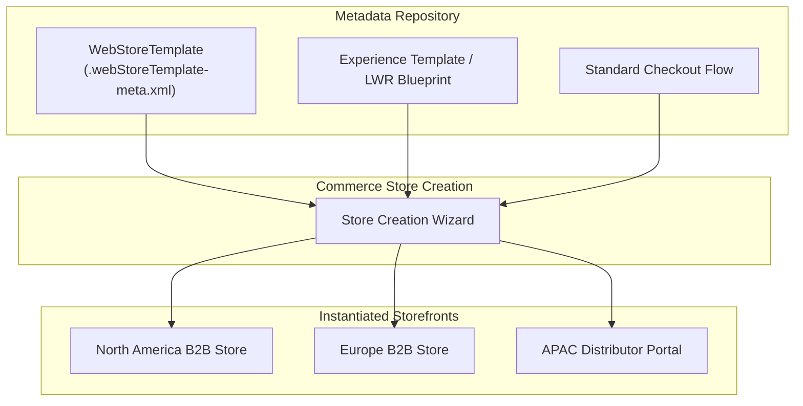

## Architectural Overview

The `WebStoreTemplate` metadata type represents a reusable storefront template definition for Salesforce B2B and D2C Commerce. When establishing enterprise-wide multi-brand or global digital commerce architectures, organizations frequently launch distinct regional or brand-specific storefronts that share standardized cart algorithms, checkout journeys, user registration flows, and catalog layouts.

Architecturally, `WebStoreTemplate` functions as an enterprise blueprint. Instead of manually re-configuring commerce settings and page structures for every new storefront, administrators select a pre-engineered `WebStoreTemplate` from the Store Creation Wizard. The template dictates the default Experience Cloud network template, responsive layout schemas, core checkout flows, and initial store feature flags.



By institutionalizing `WebStoreTemplate` within your continuous deployment and packaging pipelines, enterprise architects establish governance over commerce storefront topologies and accelerate time-to-market for new digital sales channels.

---

## Directory and File Suffix

In Salesforce DX project source structure, `WebStoreTemplate` components reside inside the `webStoreTemplates/` directory with the `.webStoreTemplate-meta.xml` file suffix:

- **Source File Path**: `force-app/main/default/webStoreTemplates/<TemplateName>.webStoreTemplate-meta.xml`

```text
force-app/
└── main/
    └── default/
        └── webStoreTemplates/
            ├── Standard_B2B_LWR_Template.webStoreTemplate-meta.xml
            └── Direct_To_Consumer_Store.webStoreTemplate-meta.xml
```

---

## Key Metadata Fields

The `.webStoreTemplate-meta.xml` descriptor exposes configuration fields governing template behavior and association:

| Field Name | Type | Required | Description |
|---|---|---|---|
| `masterLabel` | `string` | Yes | Human-readable template title displayed in the Commerce Store Creation Wizard. |
| `description` | `string` | No | Architectural summary outlining targeted store scenarios, channels, and buyer types. |
| `order` | `int` | No | Numerical sort order defining display sequence within the creation wizard. |
| `experienceBundleName` | `string` | No | Developer name of the underlying `ExperienceBundle` providing storefront pages. |
| `isDefault` | `boolean` | No | Designates whether this template is pre-selected as the default storefront blueprint. |

---

## Declarative XML Examples

### Complete WebStoreTemplate Descriptor (`webStoreTemplates/Standard_B2B_LWR_Template.webStoreTemplate-meta.xml`)

```xml
<?xml version="1.0" encoding="UTF-8"?>
<WebStoreTemplate xmlns="http://soap.sforce.com/2006/04/metadata">
    <description>Enterprise B2B Lightning Web Runtime storefront template featuring sub-second page performance and multi-tier pricing.</description>
    <experienceBundleName>B2B_LWR_Portal_Bundle</experienceBundleName>
    <isDefault>true</isDefault>
    <masterLabel>Standard B2B LWR Template</masterLabel>
    <order>1</order>
</WebStoreTemplate>
```

### Manifest Definition (`package.xml`)

```xml
<?xml version="1.0" encoding="UTF-8"?>
<Package xmlns="http://soap.sforce.com/2006/04/metadata">
    <types>
        <members>Standard_B2B_LWR_Template</members>
        <name>WebStoreTemplate</name>
    </types>
    <version>68.0</version>
</Package>
```

---

## Retrieval and Deployment

### Retrieving Store Templates via Salesforce CLI

Retrieve the store template metadata from your connected development environment:

```bash
# Retrieve a single WebStoreTemplate
sf project retrieve start --metadata "WebStoreTemplate:Standard_B2B_LWR_Template"

# Retrieve all commerce store templates in the org
sf project retrieve start --metadata "WebStoreTemplate"
```

### Deploying across Enterprise Release Pipelines

Deploy the template metadata to your target testing sandboxes or production org:

```bash
# Validate template deployment in sandbox
sf project deploy validate \
    --metadata "WebStoreTemplate:Standard_B2B_LWR_Template" \
    --target-org uat-sandbox

# Deploy the template into production
sf project deploy start \
    --metadata "WebStoreTemplate:Standard_B2B_LWR_Template" \
    --target-org production-org
```

### Inspecting WebStoreTemplate Records with Tooling API

Enterprise CI/CD validation scripts can query deployed templates using the Tooling API:

```bash
sf data query --use-tooling-api --query \
    "SELECT Id, DeveloperName, MasterLabel, Order, CreatedDate, LastModifiedDate FROM WebStoreTemplate WHERE DeveloperName = 'Standard_B2B_LWR_Template'"
```

---

## Architect Deployment Best Practices & Gotchas

> [!TIP]
> **Decouple Template Blueprints from Static Store Data:** Design `WebStoreTemplate` to reference generic experience layouts and abstract checkout flows. Avoid baking specific catalog categories or hardcoded price book IDs into the template logic.

> [!WARNING]
> **Experience Bundle Dependency Order:** If your `WebStoreTemplate` references a custom `experienceBundleName`, that experience bundle must be deployed prior to or in the exact same deployment manifest. A missing bundle reference triggers an unresolvable metadata error.

> [!NOTE]
> **Managed Packaging and ISV Distribution:** Enterprise AppExchange partners can package `WebStoreTemplate` metadata inside managed packages. This allows clients to instantly spin up industry-specific commerce stores with turnkey layouts while preserving upgradeability.
