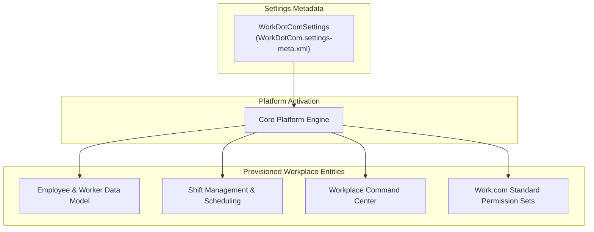

## Architectural Overview

The `WorkDotComSettings` metadata type represents organization-wide configuration for Salesforce Work.com and Employee Service solutions. Originating as an employee recognition and performance management suite and expanding into the Workplace Command Center, Shift Management, Employee Wellness, and Emergency Response Management, Work.com provides essential infrastructure for human capital and workplace operations.

Architecturally, `WorkDotComSettings` is a singleton settings metadata type that activates and governs platform-level Work.com capabilities. Enabling these settings provisions standard workplace entities (such as `Employee`, `InternalOrganizationUnit`, and `Shift`), exposes standard relationship fields, and enables platform APIs required by Work.com Lightning components and orchestration flows.



For enterprise architects, managing `WorkDotComSettings` declaratively within CI/CD pipelines ensures that scratch orgs and developer sandboxes are instantly equipped with the prerequisite runtime schema necessary to support workplace applications.

---

## Directory and File Suffix

As a member of the Salesforce `Settings` family, `WorkDotComSettings` is stored inside the `settings/` directory using the `.settings-meta.xml` file suffix:

- **Source File Path**: `force-app/main/default/settings/WorkDotCom.settings-meta.xml`

```text
force-app/
└── main/
    └── default/
        └── settings/
            ├── Security.settings-meta.xml
            └── WorkDotCom.settings-meta.xml
```

---

## Key Metadata Fields

The root `<WorkDotComSettings>` element exposes flags controlling workplace, recognition, and operational features:

| Field Name | Type | Required | Description |
|---|---|---|---|
| `enableWorkDotCom` | `boolean` | No | Master switch enabling Work.com platform features and data models across the org. |
| `enableProfileSkills` | `boolean` | No | Enables skills and certifications tracking on employee and user profiles. |
| `enableWorkThanks` | `boolean` | No | Enables the social recognition Thanks feature across Chatter feeds and employee profiles. |
| `enableWorkBadges` | `boolean` | No | Permits administrators and managers to configure and award custom recognition badges. |
| `enableShiftManagement` | `boolean` | No | Enables workplace shift scheduling, facility capacity limits, and worker availability tracking. |
| `enableWorkplaceCommandCenter` | `boolean` | No | Activates executive Workplace Command Center dashboards and status monitoring. |

---

## Declarative XML Examples

### Complete Settings File (`settings/WorkDotCom.settings-meta.xml`)

```xml
<?xml version="1.0" encoding="UTF-8"?>
<WorkDotComSettings xmlns="http://soap.sforce.com/2006/04/metadata">
    <enableProfileSkills>true</enableProfileSkills>
    <enableShiftManagement>true</enableShiftManagement>
    <enableWorkBadges>true</enableWorkBadges>
    <enableWorkDotCom>true</enableWorkDotCom>
    <enableWorkThanks>true</enableWorkThanks>
    <enableWorkplaceCommandCenter>true</enableWorkplaceCommandCenter>
</WorkDotComSettings>
```

### Manifest Definition (`package.xml`)

When retrieving or deploying settings through `package.xml`, use the `Settings` metadata type name paired with the specific setting member:

```xml
<?xml version="1.0" encoding="UTF-8"?>
<Package xmlns="http://soap.sforce.com/2006/04/metadata">
    <types>
        <members>WorkDotCom</members>
        <name>Settings</name>
    </types>
    <version>68.0</version>
</Package>
```

---

## Retrieval and Deployment

### Retrieving Settings via Salesforce CLI

Retrieve the Work.com configuration file from your connected development environment:

```bash
# Retrieve WorkDotCom settings
sf project retrieve start --metadata "Settings:WorkDotCom"

# Retrieve all organization settings
sf project retrieve start --metadata "Settings"
```

### Deploying Settings in CI/CD Pipelines

To deploy settings to scratch orgs, sandboxes, or production environments:

```bash
# Validate settings deployment
sf project deploy validate \
    --metadata "Settings:WorkDotCom" \
    --target-org uat-sandbox

# Deploy settings to production
sf project deploy start \
    --metadata "Settings:WorkDotCom" \
    --target-org production-org
```

---

## Architect Deployment Best Practices & Gotchas

> [!TIP]
> **Foundation Deployment Sequencing:** Always deploy `Settings:WorkDotCom` in "Wave 0" (the foundation layer) of your deployment pipeline. Custom fields on the standard `Employee` object or Apex triggers touching `Shift` will fail compilation if the underlying settings are not enabled beforehand.

> [!WARNING]
> **License Prerequisites in Sandboxes:** Deploying `enableWorkplaceCommandCenter` or `enableShiftManagement` requires the target org to have active Work.com or Workplace Command Center permission set licenses provisioned. In freshly refreshed sandboxes, verify license activation before initiating deployments.

> [!NOTE]
> **Scratch Org Definitions:** For automated pull request testing, include `"WorkDotCom"` in the `features` array of your `project-scratch-def.json` configuration to automatically allocate necessary feature licenses and enable smooth settings deployment.
