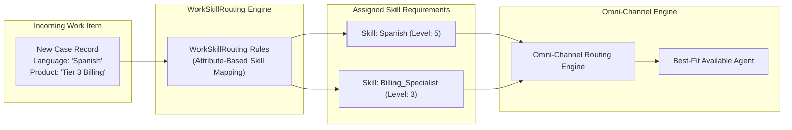

## Architectural Overview

The `WorkSkillRouting` metadata type represents declarative skills-based routing rules for Salesforce Omni-Channel. In high-complexity customer service environments, simple queue-based routing is often inadequate; cases and customer interactions require agents with specialized languages, technical certifications, regional regulatory proficiencies, or product-specific knowledge.

Architecturally, `WorkSkillRouting` decouples routing logic from procedural code. Instead of writing complex Apex triggers to generate `PendingServiceRouting` and `SkillRequirement` records, `WorkSkillRouting` declaratively maps record field values (such as `Case.Language__c = 'Spanish'` or `Case.Product_Area__c = 'Billing'`) directly to defined `Skill` metadata entities, specifying required minimum skill proficiency scores.



By versioning `WorkSkillRouting` rules in source control, contact center architects ensure consistent routing governance across development sandboxes, staging environments, and production contact centers.

---

## Directory and File Suffix

In Salesforce DX projects, `WorkSkillRouting` definitions are stored in the `workSkillRoutings/` directory with the `.workSkillRouting-meta.xml` file suffix:

- **Source File Path**: `force-app/main/default/workSkillRoutings/<RoutingRuleName>.workSkillRouting-meta.xml`

```text
force-app/
└── main/
    └── default/
        └── workSkillRoutings/
            ├── Case_Technical_Support_Routing.workSkillRouting-meta.xml
            └── Global_Billing_Skills_Routing.workSkillRouting-meta.xml
```

---

## Key Metadata Fields

The root `<WorkSkillRouting>` element encapsulates rule criteria and attribute mappings:

| Field Name | Type | Required | Description |
|---|---|---|---|
| `masterLabel` | `string` | Yes | Human-readable title of the skills-based routing rule. |
| `relatedEntity` | `string` | Yes | The target object being routed, such as `Case`, `Order`, or `WorkOrder`. |
| `isActive` | `boolean` | Yes | Controls whether the skills-based routing rule is active in Omni-Channel. |
| `workSkillRoutingAttributes` | `WorkSkillRoutingAttribute[]` | Yes | List of mappings pairing field values with required skills and levels. |

### WorkSkillRoutingAttribute Sub-Properties

- `field`: The API name of the evaluated field on the `relatedEntity` (e.g., `Language__c`).
- `value`: The target field value triggering the skill requirement (e.g., `Spanish`).
- `skill`: The developer name of the target `Skill` metadata record.
- `skillLevel`: Numerical minimum proficiency required (e.g., `5.0`).
- `isAdditionalSkill`: Indicates if the skill is optional when matching available agents.

---

## Declarative XML Examples

### Complete WorkSkillRouting Definition (`workSkillRoutings/Case_Technical_Support_Routing.workSkillRouting-meta.xml`)

```xml
<?xml version="1.0" encoding="UTF-8"?>
<WorkSkillRouting xmlns="http://soap.sforce.com/2006/04/metadata">
    <isActive>true</isActive>
    <masterLabel>Case Technical Support Routing</masterLabel>
    <relatedEntity>Case</relatedEntity>
    <workSkillRoutingAttributes>
        <field>Case.Language__c</field>
        <isAdditionalSkill>false</isAdditionalSkill>
        <skill>Spanish_Language</skill>
        <skillLevel>5.0</skillLevel>
        <value>Spanish</value>
    </workSkillRoutingAttributes>
    <workSkillRoutingAttributes>
        <field>Case.Product_Area__c</field>
        <isAdditionalSkill>false</isAdditionalSkill>
        <skill>Tier_3_Technical_Support</skill>
        <skillLevel>4.0</skillLevel>
        <value>Enterprise_Storage</value>
    </workSkillRoutingAttributes>
</WorkSkillRouting>
```

### Manifest Definition (`package.xml`)

```xml
<?xml version="1.0" encoding="UTF-8"?>
<Package xmlns="http://soap.sforce.com/2006/04/metadata">
    <types>
        <members>Spanish_Language</members>
        <members>Tier_3_Technical_Support</members>
        <name>Skill</name>
    </types>
    <types>
        <members>Case_Technical_Support_Routing</members>
        <name>WorkSkillRouting</name>
    </types>
    <version>68.0</version>
</Package>
```

---

## Retrieval and Deployment

### Retrieving Routing Rules via Salesforce CLI

Retrieve the skills routing rules from your source environment:

```bash
# Retrieve a specific WorkSkillRouting rule
sf project retrieve start --metadata "WorkSkillRouting:Case_Technical_Support_Routing"

# Retrieve all skills routing rules alongside skills definitions
sf project retrieve start --metadata "Skill,WorkSkillRouting"
```

### Deploying across Enterprise Release Pipelines

Deploy the routing rules into testing sandboxes or production environments:

```bash
# Validate routing rule syntax against sandbox
sf project deploy validate \
    --metadata "WorkSkillRouting:Case_Technical_Support_Routing" \
    --target-org uat-sandbox

# Deploy routing rules to production
sf project deploy start \
    --metadata "WorkSkillRouting:Case_Technical_Support_Routing" \
    --target-org production-org
```

### Inspecting Routing Rules with Tooling API

Enterprise CI/CD scripts can verify deployed skills routing rules via the Tooling API:

```bash
sf data query --use-tooling-api --query \
    "SELECT Id, DeveloperName, MasterLabel, RelatedEntity, IsActive FROM WorkSkillRouting WHERE DeveloperName = 'Case_Technical_Support_Routing'"
```

---

## Architect Deployment Best Practices & Gotchas

> [!TIP]
> **Pre-deploy Skill Definitions:** Every skill referenced in `<skill>` must exist as an active `Skill` metadata component in the target org. Always bundle `Skill` metadata alongside `WorkSkillRouting` in your release manifests.

> [!WARNING]
> **Field Dependency Validation:** If a routing rule references a custom picklist or text field (`Case.Product_Area__c`), that field must exist on the target entity prior to deployment. Deploy custom fields before activating routing rules.

> [!NOTE]
> **Flow Route Work Integration:** While `WorkSkillRouting` handles attribute-based mapping natively, advanced architectures can also combine attribute rules with the Omni-Channel **Route Work** action in Flow Builder (`metadata/flow-metadata-type`) for dynamic real-time skill calculation.
