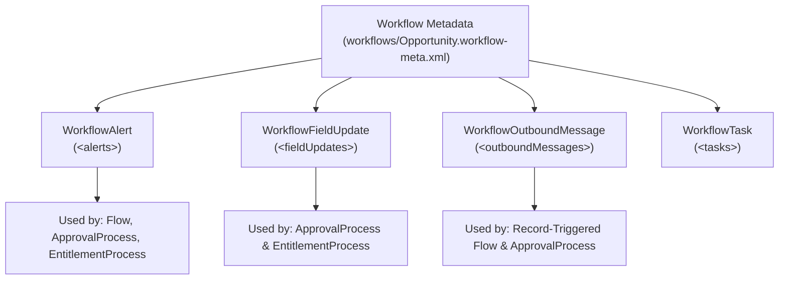

## Why the `Workflow` Metadata Type Is Still Critical After Workflow Rule Retirement

A common misconception among developers is that because Salesforce retired **Workflow Rules** (`WorkflowRule`), the **`Workflow`** metadata type (`workflows/<ObjectName>.workflow-meta.xml`) is obsolete. In reality, `Workflow` is the metadata container for four reusable action primitives that modern Salesforce features still depend on every day:

1. **`WorkflowAlert` (Email Alerts):** Directly invoked by **Record-Triggered Flows** (`emailAlert` action), [ApprovalProcess](/docs/metadata/approval-process-metadata-type/), and [EntitlementProcess](/docs/metadata/entitlement-process-metadata-type/) milestone actions.
2. **`WorkflowFieldUpdate` (Field Updates):** Required for initial submission, approval, rejection, and recall actions inside every [ApprovalProcess](/docs/metadata/approval-process-metadata-type/) and [EntitlementProcess](/docs/metadata/entitlement-process-metadata-type/).
3. **`WorkflowOutboundMessage` (Outbound Messages):** Declarative SOAP XML webhook notifications with automatic 24-hour retry queues, invocable directly from **Record-Triggered Flows**.
4. **`WorkflowTask` (Task Actions):** Assigned tasks triggered by Approval Processes and Entitlement Milestones.



---

## Granular Child Metadata Types Supported in `package.xml`

Even though SFDX stores all actions for an object inside a single `workflows/<Object>.workflow-meta.xml` file, you can retrieve and deploy individual actions using their granular metadata type names:

| Child Metadata Type | XML Element in `.workflow-meta.xml` | `package.xml` Member Syntax |
|---|---|---|
| `WorkflowAlert` | `<alerts>` | `<ObjectName>.<AlertDeveloperName>` |
| `WorkflowFieldUpdate` | `<fieldUpdates>` | `<ObjectName>.<FieldUpdateDeveloperName>` |
| `WorkflowOutboundMessage` | `<outboundMessages>` | `<ObjectName>.<OutboundMessageDeveloperName>` |
| `WorkflowTask` | `<tasks>` | `<ObjectName>.<TaskDeveloperName>` |
| `WorkflowRule` | `<rules>` | `<ObjectName>.<RuleName>` *(Legacy maintenance only)* |

---

## Real-World XML Example (`workflows/Quote.workflow-meta.xml`)

```xml
<?xml version="1.0" encoding="UTF-8"?>
<Workflow xmlns="http://soap.sforce.com/2006/04/metadata">
    <alerts>
        <fullName>Quote_Approved_Customer_Notification</fullName>
        <ccEmails>deal-desk@acme.example.com</ccEmails>
        <description>Notifies the primary contact and deal desk when a Quote is approved.</description>
        <protected>false</protected>
        <recipients>
            <field>ContactId</field>
            <type>contactLookup</type>
        </recipients>
        < recipients>
            <type>owner</type>
        </recipients>
        <senderAddress>quotes@acme.example.com</senderAddress>
        <senderType>OrgWideEmailAddress</senderType>
        <template>Sales_Templates/Quote_Approval_Confirmation</template>
    </alerts>
    <fieldUpdates>
        <fullName>Set_Status_To_Approved</fullName>
        <field>Status</field>
        <literalValue>Approved</literalValue>
        <name>Set Status To Approved</name>
        <notifyAssignee>false</notifyAssignee>
        <operation>Literal</operation>
        <protected>false</protected>
        <reevaluateOnChange>false</reevaluateOnChange>
    </fieldUpdates>
    <outboundMessages>
        <fullName>Sync_Approved_Quote_To_ERP</fullName>
        <apiVersion>68.0</apiVersion>
        <endpointUrl>https://erp-gateway.acme.example.com/soap/quote-sync</endpointUrl>
        <fields>Id</fields>
        <fields>QuoteNumber</fields>
        <fields>GrandTotal</fields>
        <includeSessionId>false</includeSessionId>
        <integrationUser>integration.bot@acme.example.com</integrationUser>
        <name>Sync Approved Quote To ERP</name>
        <protected>false</protected>
        <useDeadLetterQueue>false</useDeadLetterQueue>
    </outboundMessages>
</Workflow>
```

---

## Querying `WorkflowAlert`, `WorkflowFieldUpdate`, and `WorkflowOutboundMessage` via Tooling API

You can audit email alerts, outbound webhook endpoints, and field updates across your org using the **Tooling API**.

### 1. Audit All Email Alerts and Their Sender Addresses (Tooling API)

```sql
SELECT Id, DeveloperName, EntityDefinition.QualifiedApiName,
       SenderType, Description, CcEmails, LastModifiedDate
FROM WorkflowAlert
WHERE NamespacePrefix = null
ORDER BY EntityDefinition.QualifiedApiName, DeveloperName
```

### 2. Audit All Outbound Message Endpoints and Integration Users (Tooling API)

```sql
SELECT Id, Name, EntityDefinition.QualifiedApiName, EndpointUrl,
       ApiVersion, IntegrationUserId
FROM WorkflowOutboundMessage
WHERE NamespacePrefix = null
```

---

## Senior Architect Gotchas

> [!WARNING]
> **Environment-Specific `<integrationUser>` and `<senderAddress>`:** Notice that `<WorkflowOutboundMessage>` hardcodes `<integrationUser>` by username, and `<WorkflowAlert>` hardcodes `<senderAddress>` when `<senderType>OrgWideEmailAddress</senderType>` is used. Both will fail CI/CD deployment to Sandboxes or Scratch Orgs unless you configure `replacements` in `sfdx-project.json`!
