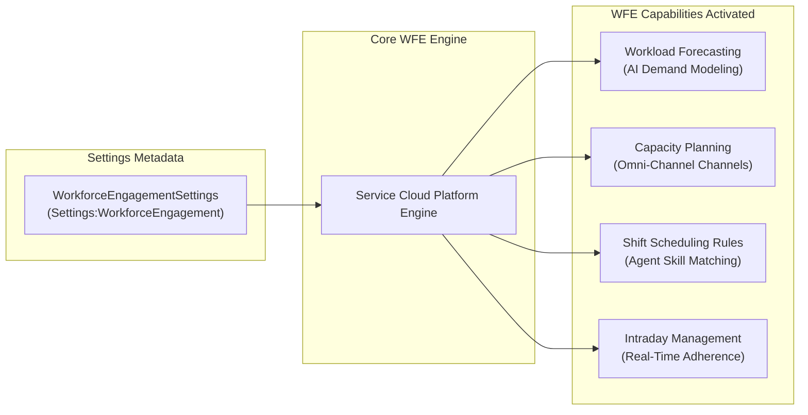

## Architectural Overview

The `WorkforceEngagementSettings` metadata type represents organization-wide settings for Service Cloud Workforce Engagement (formerly Workforce Management / WFM). In mission-critical global contact centers, matching agent staffing schedules with dynamic, multichannel customer inquiry volumes is vital for maintaining service-level agreements (SLAs) while controlling operational labor costs.

Architecturally, `WorkforceEngagementSettings` acts as the master feature activation switch for Salesforce's native contact center workforce management platform. Enabling these settings turns on Omni-Channel capacity modeling, intelligent workload forecasting algorithms (leveraging historical CRM interaction data), automated shift generation engines, and real-time intraday management dashboards.



When building automated CI/CD pipelines for contact center modernizations, deploying `WorkforceEngagementSettings` in the foundational phase is essential for enabling dependent shift templates, skill requirements, and routing automation.

---

## Directory and File Suffix

As a member of the Salesforce `Settings` family, `WorkforceEngagementSettings` resides inside the `settings/` directory using the `.settings-meta.xml` file suffix:

- **Source File Path**: `force-app/main/default/settings/WorkforceEngagement.settings-meta.xml`

```text
force-app/
└── main/
    └── default/
        └── settings/
            ├── Omnichannel.settings-meta.xml
            └── WorkforceEngagement.settings-meta.xml
```

---

## Key Metadata Fields

The root `<WorkforceEngagementSettings>` descriptor encapsulates flags controlling capacity, forecasting, and operational management:

| Field Name | Type | Required | Description |
|---|---|---|---|
| `enableWorkforceEngagement` | `boolean` | No | Master activation switch for Service Cloud Workforce Engagement platform features. |
| `enableOmniCapacityPlan` | `boolean` | No | Enables capacity planning across Omni-Channel queues, routing configurations, and service channels. |
| `enableWorkforceForecasting` | `boolean` | No | Activates machine-learning models that generate staffing demand forecasts from historical case data. |
| `enableIntradayManagement` | `boolean` | No | Enables real-time monitoring of agent schedule adherence and intraday workload adjustments. |

---

## Declarative XML Examples

### Complete Settings Descriptor (`settings/WorkforceEngagement.settings-meta.xml`)

```xml
<?xml version="1.0" encoding="UTF-8"?>
<WorkforceEngagementSettings xmlns="http://soap.sforce.com/2006/04/metadata">
    <enableIntradayManagement>true</enableIntradayManagement>
    <enableOmniCapacityPlan>true</enableOmniCapacityPlan>
    <enableWorkforceEngagement>true</enableWorkforceEngagement>
    <enableWorkforceForecasting>true</enableWorkforceForecasting>
</WorkforceEngagementSettings>
```

### Manifest Definition (`package.xml`)

When retrieving or deploying settings via `package.xml`, pair the `Settings` metadata type with the `WorkforceEngagement` member name:

```xml
<?xml version="1.0" encoding="UTF-8"?>
<Package xmlns="http://soap.sforce.com/2006/04/metadata">
    <types>
        <members>WorkforceEngagement</members>
        <name>Settings</name>
    </types>
    <version>68.0</version>
</Package>
```

---

## Retrieval and Deployment

### Retrieving Settings via Salesforce CLI

Retrieve the settings file from your development environment:

```bash
# Retrieve Workforce Engagement settings
sf project retrieve start --metadata "Settings:WorkforceEngagement"

# Retrieve all settings across the organization
sf project retrieve start --metadata "Settings"
```

### Deploying across Enterprise Release Pipelines

Deploy the configuration into staging sandboxes or production orgs:

```bash
# Validate settings deployment in target sandbox
sf project deploy validate \
    --metadata "Settings:WorkforceEngagement" \
    --target-org uat-sandbox

# Deploy settings to production
sf project deploy start \
    --metadata "Settings:WorkforceEngagement" \
    --target-org production-org
```

---

## Architect Deployment Best Practices & Gotchas

> [!TIP]
> **Omni-Channel Co-requisites:** Workforce Engagement is built directly atop Service Cloud Omni-Channel. Ensure that `OmnichannelSettings` (`enableOmnichannel: true`) and associated `ServiceChannel` definitions are enabled prior to or alongside `WorkforceEngagementSettings`.

> [!WARNING]
> **Permission Set License Verification:** Workforce Engagement requires dedicated user licenses (such as Workforce Engagement Planner, Manager, or Agent licenses). Attempting to deploy `WorkforceEngagementSettings` to a sandbox where these licenses have not been provisioned will result in deployment failure.

> [!NOTE]
> **Pipeline Phase Sequencing:** Deploy `WorkforceEngagementSettings` in Phase 0 of your CI/CD pipeline before deploying custom shifts, workload history records, or automated scheduling Flows (`metadata/flow-metadata-type`).
