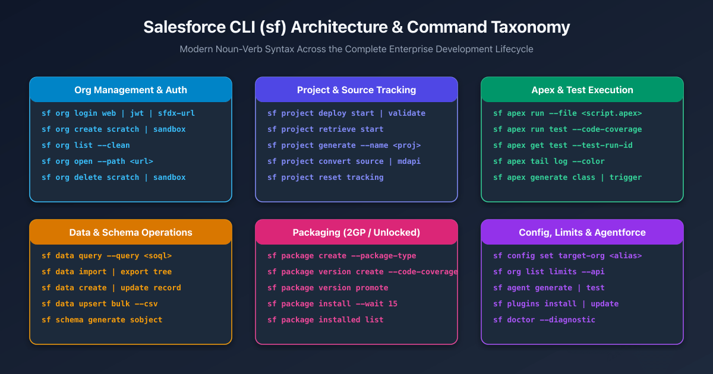
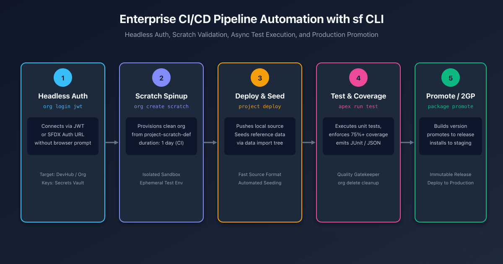

## Overview

The **Salesforce CLI** (`sf`) is the foundational tool for modern Salesforce development, continuous integration, and release engineering. Built on top of the open-source OCLIF framework, the CLI unifies all platform developer tasks—org authorization, source code synchronization, automated testing, data seeding, package generation, and Agentforce configuration—into a single, high-performance command-line interface.

Historically, Salesforce developers relied on the legacy `sfdx` executable (e.g., `sfdx force:source:push`). In the modern Salesforce CLI, all commands adopt a clear, predictable **noun-verb syntax** (`sf <topic> <verb>`, such as `sf project deploy start` or `sf org create scratch`).



---

## Core Command Taxonomy & Syntax

The `sf` CLI organizes capabilities into high-level topical domains:

| Command Group | Focus Area | Primary Verbs / Subcommands |
| :--- | :--- | :--- |
| **`sf org`** | Environment lifecycle & authentication | `login`, `create`, `list`, `open`, `delete`, `display` |
| **`sf project`** | Source code & metadata synchronization | `generate`, `deploy`, `retrieve`, `convert`, `reset` |
| **`sf apex`** | Business logic & unit test execution | `run`, `generate`, `tail`, `get` |
| **`sf data`** | Database queries & bulk operations | `query`, `create`, `update`, `delete`, `import`, `export` |
| **`sf package`** | Second-Generation Packaging (2GP) | `create`, `version create`, `version promote`, `install` |
| **`sf config`** | Local & global CLI preferences | `set`, `get`, `list`, `unset` |
| **`sf agent`** | Agentforce AI agent development | `generate`, `test`, `preview` |

---

## 1. Org Management & Authentication (`sf org`)

Managing org connections is the first step in any CLI workflow. The CLI stores credentials securely in your local user directory (`~/.sfdx/` and `~/.sf/`).

### Interactive Web Login
Authorize a sandbox or production environment using a browser-based OAuth 2.0 PKCE flow:

```bash
# Authorize production or Developer Edition org with an alias
sf org login web --alias DevHub --set-default-dev-hub

# Authorize a sandbox org
sf org login web --instance-url https://test.salesforce.com --alias UATSandbox --set-default
```

### Headless CI/CD Authentication (JWT & Auth URL)
In automated GitHub Actions, GitLab CI, or Jenkins pipelines where no browser exists, authenticate headlessly:

```bash
# 1. JWT Bearer Token Flow (Recommended for enterprise CI/CD)
sf org login jwt \
  --client-id 3MVG9... \
  --jwt-key-file server.key \
  --username ci-bot@mycompany.com \
  --instance-url https://login.salesforce.com \
  --alias Production

# 2. SFDX Auth URL Flow (Single string stored in CI secrets)
sf org login sfdx-url --sfdx-url-file authFile.txt --alias Staging
```

### Scratch Orgs & Sandboxes
```bash
# Create a 7-day scratch org from a definition file
sf org create scratch \
  --definition-file config/project-scratch-def.json \
  --alias feature-lead-scoring \
  --duration-days 7 \
  --set-default

# Create an ephemeral developer sandbox from production
sf org create sandbox \
  --name DevSandbox1 \
  --license-type Developer \
  --target-org Production \
  --wait 30

# List all authorized orgs and active scratch org expiration dates
sf org list --clean

# Open an org directly to a specific Lightning page or record
sf org open --path lightning/o/Account/list?filterName=Recent
```

---

## 2. Project & Source Operations (`sf project`)

Modern Salesforce DX projects store declarative configuration and code in human-readable, fine-grained **source format** (`force-app/main/default/`).

### Scaffolding a New Project
```bash
# Generate a standard DX project with manifest folder
sf project generate --name my-billing-service --template standard --manifest
```

### Deploying & Retrieving Source
The `sf project deploy start` command replaces both legacy `force:source:push` and `force:source:deploy`:

```bash
# Deploy local source to the default org (uses source tracking if supported)
sf project deploy start

# Deploy a specific directory or individual Apex class
sf project deploy start --source-dir force-app/main/default/classes/InvoiceHandler.cls

# Deploy metadata defined in a manifest package.xml
sf project deploy start --manifest manifest/package.xml --target-org UATSandbox

# Validate a deployment without committing changes (dry run)
sf project deploy validate --manifest manifest/package.xml --target-org Production
```

### Quick Deploy (Validating then Deploying in Production)
To minimize deployment downtime during weekend releases, validate first and then execute a **Quick Deploy** using the returned Job ID:

```bash
# Step 1: Validate and run local tests
sf project deploy validate --manifest manifest/package.xml --test-level RunLocalTests --target-org Production

# Step 2: Quick deploy using the validated Job ID (skips running tests again!)
sf project deploy quick --job-id 0AfB00000012345KAA --target-org Production
```

### Retrieving Changes
```bash
# Retrieve metadata from the org into local project files
sf project retrieve start --manifest manifest/package.xml
```

---

## 3. Apex, Testing & Debugging (`sf apex`)

### Executing Anonymous Apex
```bash
# Run an Apex script file against target org
sf apex run --file scripts/apex/recalculate_totals.apex

# Run interactively in the terminal (terminate with CTRL+D)
sf apex run --target-org DevHub
```

### Running Unit Tests with Code Coverage
```bash
# Run all local tests with code coverage calculation and wait for completion
sf apex run test \
  --test-level RunLocalTests \
  --code-coverage \
  --result-format human \
  --wait 20 \
  --target-org UATSandbox

# Run a specific test class and output JUnit XML for CI/CD pipelines
sf apex run test \
  --class-names InvoiceHandlerTest \
  --result-format junit \
  --output-dir test-reports/
```

### Real-Time Log Tailing
Stream live Salesforce debug logs directly into your terminal with colored syntax:

```bash
sf apex tail log --color --debug-level FINEST
```

---

## 4. Data & Schema Operations (`sf data`)

The CLI allows developers to query, insert, and seed test data without opening the Salesforce user interface.

```bash
# Execute a SOQL query and format output as a terminal table
sf data query --query "SELECT Id, Name, StageName, Amount FROM Opportunity WHERE IsClosed = false LIMIT 10"

# Export query results in JSON format
sf data query --query "SELECT Id, Name FROM Account" --json

# Create a single record
sf data create record --sobject Account --values "Name='Acme Corp' Industry='Technology'"

# Seed complex parent-child relational test data trees
sf data export tree --query "SELECT Id, Name, (SELECT Id, LastName, Email FROM Contacts) FROM Account" --output-dir data/
sf data import tree --files data/Account.json
```

---

## 5. Second-Generation Packaging (`sf package`)

Second-Generation Packaging (2GP) is the modern standard for modular Salesforce application development.

```bash
# 1. Create a new unlocked package associated with your Dev Hub
sf package create \
  --name "CoreBillingModule" \
  --package-type Unlocked \
  --path force-app \
  --target-dev-hub DevHub

# 2. Build a new immutable package version
sf package version create \
  --package "CoreBillingModule" \
  --installation-key-bypass \
  --code-coverage \
  --wait 30

# 3. Promote the package version to GA status (immutable release)
sf package version promote --package "CoreBillingModule@1.4.0-1" --no-prompt

# 4. Install the package version into a sandbox or production org
sf package install --package 04tB00000012345KAA --wait 15 --target-org Production
```

---

## CI/CD Pipeline Automation: The Golden Flow

Enterprise teams integrate `sf` commands into automated continuous integration pipelines (such as GitHub Actions). Every pull request spins up an isolated scratch org, deploys code, runs unit tests, and tears down the environment.



```yaml title=".github/workflows/salesforce-pr-validation.yml"
name: Salesforce PR Validation

on:
  pull_request:
    branches: [ main ]

jobs:
  validate-scratch-org:
    runs-on: ubuntu-latest
    steps:
      - name: Checkout Source Code
        uses: actions/checkout@v4

      - name: Install Node.js & Salesforce CLI
        uses: actions/setup-node@v4
        with:
          node-version: 22
      - run: npm install -g @salesforce/cli

      - name: Authenticate Dev Hub via JWT
        run: |
          echo "${{ secrets.SFDC_SERVER_KEY }}" > server.key
          sf org login jwt \
            --client-id ${{ secrets.SFDC_CLIENT_ID }} \
            --jwt-key-file server.key \
            --username ${{ secrets.SFDC_DEVHUB_USER }} \
            --alias DevHub \
            --set-default-dev-hub

      - name: Create Ephemeral Scratch Org
        run: |
          sf org create scratch \
            --definition-file config/project-scratch-def.json \
            --alias pr-env \
            --duration-days 1 \
            --set-default \
            --wait 15

      - name: Deploy Local Source
        run: sf project deploy start

      - name: Run Apex Tests with Code Coverage Gate
        run: |
          sf apex run test \
            --test-level RunLocalTests \
            --code-coverage \
            --wait 20 \
            --result-format junit \
            --output-dir test-results

      - name: Destroy Scratch Org (Cleanup)
        if: always()
        run: sf org delete scratch --no-prompt
```

---

## Migration Cheatsheet: Legacy `sfdx` vs Modern `sf`

| Task | Legacy `sfdx` Syntax (Deprecated) | Modern `sf` Syntax (Recommended) |
| :--- | :--- | :--- |
| **Web Login** | `sfdx auth:web:login -a MyOrg` | `sf org login web --alias MyOrg` |
| **JWT Login** | `sfdx auth:jwt:grant -u user -f key.key -i id` | `sf org login jwt --username user --jwt-key-file key.key --client-id id` |
| **Create Scratch Org** | `sfdx force:org:create -f def.json -a org` | `sf org create scratch --definition-file def.json --alias org` |
| **Push / Deploy Source** | `sfdx force:source:push` / `force:source:deploy` | `sf project deploy start` |
| **Pull / Retrieve Source** | `sfdx force:source:pull` / `force:source:retrieve` | `sf project retrieve start` |
| **Run Apex Tests** | `sfdx force:apex:test:run -c -r human` | `sf apex run test --code-coverage --result-format human` |
| **Execute SOQL Query** | `sfdx force:data:soql:query -q "..."` | `sf data query --query "..."` |
| **Create Package Version** | `sfdx force:package:version:create -p pkg` | `sf package version create --package pkg` |
| **Check Org Limits** | `sfdx force:limits:api:display` | `sf org list limits` |
